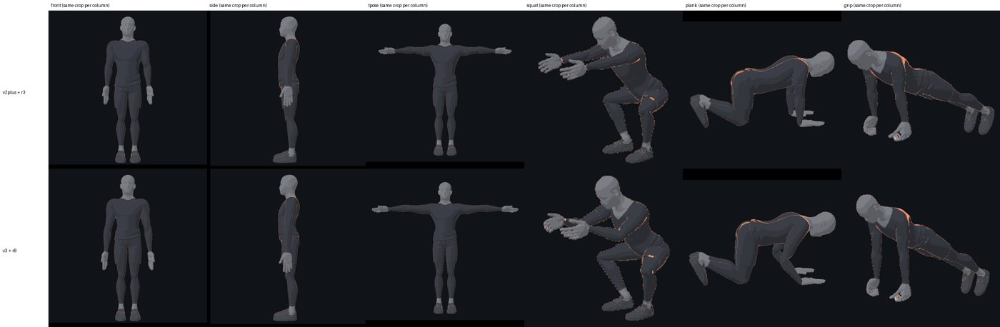
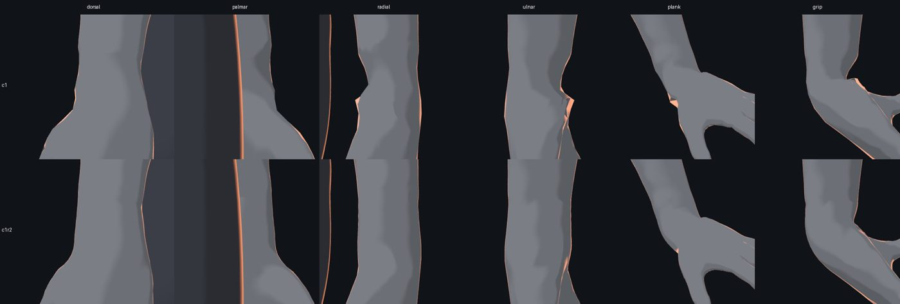
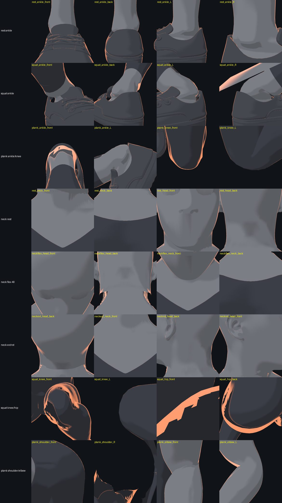

# 身体 v3 交接文档（feat/body-v3）

> 给无上下文的接手 agent。规则见仓库根目录 `AGENTS.md`：
> - 冻结或已登记 SHA 的文件一律不能覆盖（v2/v2plus 模型文件、`viewer.js`/`boot.mjs`、hands-native r3–r8、c1、c2、c1r2）；
> - 要改就新建版本，比如 `hands-native-c1r3`、`-rN`；
> - 新增候选要带 manifest，并登记 sha256；
> - 不要提交 `drill-anim/config.json` 和任何密钥。

## 1. 现状

### 1.1 v3 是什么
v3 是在 v2plus（`training-human-v2plus` 1.0.0-rc2）基础上做的比例修正，详见 `drill-anim/models/training-human-v3/proportion-audit.md`：
- 上臂 ×1.256（0.322 m），前臂 ×1.108，大腿 ×1.161，小腿 ×1.017；
- 躯干（pelvis→torso）缩短，髋点上移 0.064 m；
- 指尖下垂高度约 0.64 m，常模为 0.65 m。

v3 是**加载时变形**，没有重新烘焙 glb：
- `tools/body-v3/make_rig_v3.py` 生成 `runtime/public/coach-v3/coach-rig-v3.json`（带 `v3` 块）。
- `runtime/src/body-warp-v3.js` 做分段线性拉伸，按蒙皮权重混合，在真实蒙皮矩阵下改写成 Float32，并重算 boneInverse。
- `runtime/src/viewer-v3.js` 是 `viewer.js` 的副本，在创建 motion 之前调用 `warpModelV3`。原 `viewer.js` 冻结、没有改动。
- `drill-anim/models/training-human-v3/boot-v3.mjs` 是 `boot.mjs` 的副本，把 `/src/viewer.js` 路由到 `viewer-v3.js`。
- `drill-anim/models/training-human-v3/loader.mjs` 的 `applyV3(page, spec, {handScale=1.18, handDir='hands-native-c1r2'})`：
  - 用同一映射变形 v2plus 的躯干、四肢和手部 JSON；
  - 移动袖口平面；
  - 注入 `human-v3.js`（`page/human-v2plus.js` 的副本）和 r5 手腕扭转运行时（`hands-native-r5/wrist-twist.js`）。
- spec 需要带 `modelProfile:'training-human-v2plus-hands-native'`，以及 `v2plus:{outfit:'compression',torso:'base',limbs:'base',hands:'base',skin:'realistic'}`，否则 base 网格的手不会显示。

### 1.2 手：hands-native-c1r2（默认）
- 来源：MakeHuman hm08 base mesh，许可 **CC0 1.0**。
  - `base.obj` 文件头写明 "explicitly released as CC0 in september 2020"；
  - 依据：https://github.com/makehumancommunity/makehuman/blob/master/LICENSE.md 第 C 节，以及 LICENSE.ASSETS.md。
- 构建链路：
  1. `tools/body-v3/hands-c/mk_c1.py`：把左手摆到 v2 leftHand 坐标系。
  2. `tools/human-v2plus/hands-native/fit_hand.py --weight-end 0.028`：拟合手指骨。
  3. `tools/body-v3/hands-c/build_c.py 0.851 0.035 1.0`（`XBLEND=0.028`）：缩放到 r8 尺寸（v2 空间 158/70/28 mm）→ 得到 c1。
  4. `tools/body-v3/hands-c/build_c1r2.py 0.010` → 得到 c1r2：
     - 一级 Loop 细分，接缝顶点固定；
     - 从小臂环到手骨前 10 mm 截面，按角度单调重建过渡；
     - 做 Taubin 平滑；
     - 重算法线，接缝法线与 limbs 片共享。
- v3 中 `handScale 1.18` 对应约 187 mm 的手长。手指骨映射和姿势与 r 系列一致。
- 熊爬时手攥成拳，原因是重定向时手的姿势没处理好，不是手模的问题。平掌应使用 `palm-floor` 姿势（可以用 spec 的 `v2plus.handPose` 覆盖）。

### 1.3 预览与渲染
所有命令都在 `drill-anim/` 目录下运行。
- 先启动 vite：在仓库根目录运行 `npx vite --host 127.0.0.1 --port 8830`。
- 整体评审：`node ../tools/body-v3/v3render.mjs v3h <out>`，模式可选 `v2` / `v3` / `v3h`。
- 手候选对比：`node ../tools/body-v3/candrender.mjs hands-native-c1r2 <out>`。
- 手腕特写：`node ../tools/body-v3/wristrender.mjs hands-native-c1r2 <out>`。
- 关节审计：`node ../tools/body-v3/joints-audit/jointaudit.mjs <out>`。
  - 加 `V2=1` 跑 v2 对照，加 `NECKONLY=1` 只跑颈部姿势。
  - 跑完后用 `python3 jm.py` / `jm2.py` 出数据。
  - 注意：脚本里写死了 `/workspace/ph` 和 `/workspace/body-v3/joints` 路径，换机器要先改。

### 1.4 校验
- `npm run -s verify`（退出码 0）
- `npm run -s test:portability`（输出 OK）
- `node drill-anim/tools/catalog.mjs --check`（输出 up to date）

图：
- 
- 
- 

完整审计报告：`tools/body-v3/joints-audit/joints-audit.md`。数据文件：`joints-metrics.json`、`joints-seams.json`。

**审计结论：下列 1–5 项在 v2 上数值完全相同，都是原始 v2plus/glb 的问题，不是 v3 变形引入的。**

## 2. 待修复 / 优化项（按优先级）

### P1 脚踝皮肤从鞋口穿出（约 9 mm）
- **问题位置**：网格 `Coach_Body` 脚踝/脚部保留的面（y≈0.08–0.2 m）对 `Coach_Sneakers` 鞋口；骨骼 leftShin/leftFoot（右侧同理）。
- **现象与数据**：
  - 小腿与脚的焊缝间隙是 0 mm，这部分没问题。
  - 有 106 个鞋口顶点落在脚踝皮肤内侧，也就是皮肤鼓到了鞋外。
  - 穿出深度：静止 6.7 mm，深蹲（a-deep-squat-r3）9.2 mm，熊爬 9.4 mm。
  - 截图里鞋口上沿有锯齿状的皮肤边。
- **根因**：脚踝皮肤和鞋子各自绑定骨骼，背屈时小腿皮肤会甩出鞋口。
- **修复方法**：新建 `-rN` 版本的 body/feet 数据，不要改 glb：
  1. 在 rest 姿态下，把鞋口带（鞋口以下约 30 mm）的皮肤顶点沿鞋内表面 SDF 向内推 ≥3 mm；
  2. 把这些顶点的权重向 leftFoot 混合，与鞋口权重一致；
  3. 备选方案：抬高鞋口，或加一圈袜口网格。
- **验收标准**：运行 `jointaudit.mjs` + `jm.py`，在 rest/squat/plank/fold 四个状态下：
  - "pen shoe inside foot" 的 n 为 0，或 max ≤1 mm；
  - 焊缝间隙仍为 0；
  - 截图里鞋口没有皮肤露出。

### P2 低头 40° 时头颈裂开
- **问题位置**：`Toon_Mannequin_Head_v5` 的颈部开口（230 个边界点，y≈1.46–1.5）对 `Mesh001`（颈部皮肤）；骨骼 neck/head。
- **现象与数据**：

  | 姿势 | 间隙 p50 | 间隙 max | 法线夹角 |
  |---|---|---|---|
  | 静止 | 1.7 mm | 3.3 mm | — |
  | 低头 40° | 15 mm | 31 mm | 33–50° |
  | 仰头 35° | — | 25 mm | — |
  | 转头 65° | — | 12 mm | — |

  - 耳后和下颌角有碎片状的瑕疵。
  - 现有动作里颈部只偏 7.5–12.5°，所以目前不太显眼；一旦做颈部动作就是高优先级。
- **根因**：头部网格刚性跟随 head 骨，颈部皮肤在 neck/torso 之间混合权重，弯曲时两者分离。
- **修复方法**：仿照 c1r2 手腕的做法（参考 `tools/body-v3/hands-c/build_c1r2.py` 和 `fit_hand.py` 里的 zipper + bilaplace_fair + seam 共享法线）：
  1. 把头部开口焊到颈部的一圈顶点上，接缝顶点取颈部的实时位置；
  2. 在约 25 mm 的过渡带里，权重从 head 渐变到 neck；
  3. 重算法线。
  4. 产物放新目录，例如 `models/head-neck-weld-r1/`，并由 v3 loader 注入。
- **验收标准**：
  - `NECKONLY=1 jointaudit.mjs` + `jm2.py`：低头/仰头/转头三个姿势下 "head opening->Mesh001" 的 gap_max ≤2 mm，nrm_p50 ≤5°；
  - 后视和侧视截图里没有碎片。

### P3 领口与颈根没有焊接，只是叠在一起
- **问题位置**：`V2P_Base_Torso` 的上沿边界（约 96 个点，y 1.35–1.46）对 `Mesh001` 的颈根。
- **现象与数据**：
  - 躯干边缘悬空，离颈部 13 mm（p50），最大 27 mm，法线差 9–22°；
  - 颈根埋进躯干 10–16 mm（约 490 个顶点）；
  - 目前被上衣 `Mesh005` 的领口挡住，换低领服装或耸肩时会露出来。
- **根因**：v2plus 的躯干片和颈部只是重叠，没有缝合。
- **修复方法**：用 fit_hand 的 zipper + fairing 把躯干上沿缝到颈部的一圈顶点上，接缝法线共享。产物做成新的 torso-base 版本（`-rN`），不能覆盖 v2plus 的原文件。
- **验收标准**：`jm2.py` 中 "neck bottom Mesh001->torso" 和躯干上沿的 gap_max ≤2 mm，nrm_max ≤10°；去掉上衣后截图里看不到台阶。

### P4 深蹲时髋、膝疑似穿模（先确认）
- **问题位置**：`V2P_Base_Limbs` / `V2P_Base_Torso` / `Coach_Training_Shorts`；骨骼 leftThigh/leftShin/pelvis。
- **现象与数据**：
  - 深蹲特写里髋部褶皱处和膝周有锯齿状的穿模带；
  - 膝窝顶点到骨骼的距离缩到静止时的 0.04×（最小）/ 0.29–0.36×（p5）。
- **注意**：当前机位可能有一部分在模型内部，**要先换机位重拍确认**：
  - 机位放在大腿外侧和正前方，距离 ≥0.6 m；
  - 同时看最低帧和 1/2 下蹲帧。
- **根因（推测）**：线性混合蒙皮，加上大腿、小腿、腹部互相挤压。
- **修复方法**：确认后，加屈膝/屈髋时的形状修正（pose-space corrective），或者给 limbs 片改用双四元数蒙皮。
- **验收标准**：重拍后没有可见的穿模；膝窝 ratio_p5 ≥0.5，且没有面片翻转。

### P5 熊爬时肩部拉伸
- **问题位置**：`V2P_Base_Torso` 肩部；骨骼 leftUpperArm（三角肌外侧）。
- **现象与数据**：熊爬和坐姿体前屈中，肩部顶点距离 p95 被拉到 2.0–2.5×；p5 在熊爬中 0.39–0.51；熊爬右侧视角有碎片。肘部只是正常褶皱。
- **根因**：线性混合蒙皮，上臂缺少扭转/辅助骨。
- **修复方法**：加上臂扭转骨，或做肩部形状修正。
- **验收标准**：熊爬中肩部 ratio_p95 ≤1.4，截图里没有碎片。

### v3 遗留问题
- **L1 手腕处袖子到皮肤的颜色渐变失效**
  - 现状：在 r7 运行时补丁和 `human-v3.js` 里都试过加渐变，都没生效。
  - 原因：原生手模式下 `uV2pOut` 关闭，手的颜色不经过 limbs/W4 着色分支。
  - 要做的：先追查 `human-v3.js` 里 hands 网格的材质和 onBeforeCompile 走的是哪条路径，在那条路径上加基于手部局部 x 的渐变。
  - 验收：手腕特写里看不到颜色分界线。
- **L2 拉长后的手臂边缘有亮点**
  - 原因：`body-warp-v3.js` 改写了位置，但没有重算法线。
  - 要做的：在 warp 之后按蒙皮后的 rest 姿态重算法线；接缝处要和相邻片共享法线。
  - 验收：`v3render.mjs v3` 的手臂边缘没有斑点。
- **L3（可选）烘焙 `flare-coach-v3.glb`**：把加载时变形固化下来，这样就不再需要 viewer-v3 这条运行时路径。烘焙产物要新建版本，并登记 SHA。

## 3. 后续阶段（不属于本次交接，除非另有指示）
- 重定向工具：把旧动作的手部/接触点自动适配到 v3 比例。
- 241 个动作迁移成 `-rN` 新规格，原规格不覆盖。
- 276 条接触记录重新测量。
- 媒体、catalog、版本台账（`docs/version-ledger.md`）、SDK 版本号提升。
