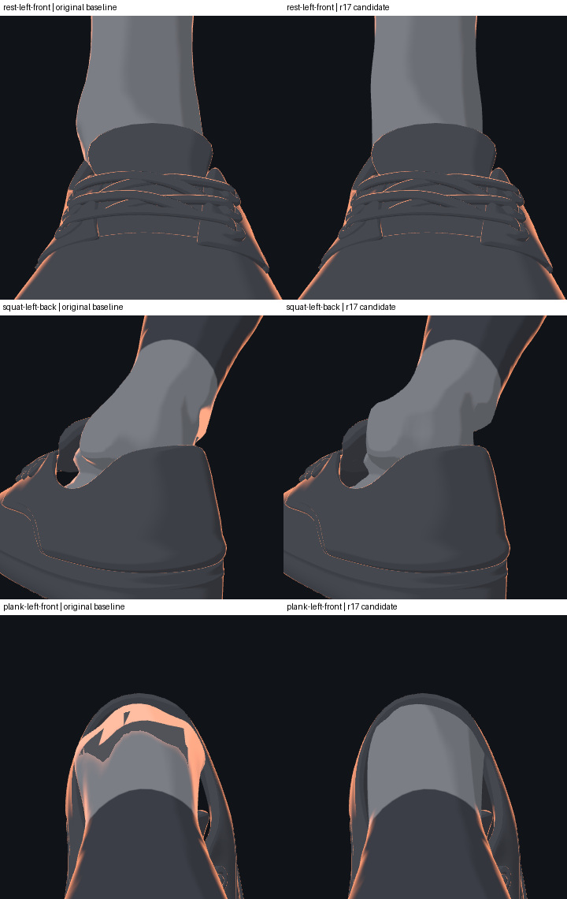
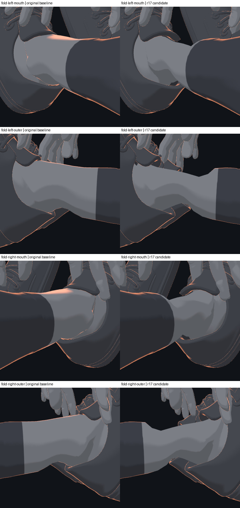

# Body v3 ankle and shoe opening: P1 review

P1 uses the reviewed r17 geometry, weights and ankle shader, with visible inner
surfaces on the two shoe materials. The original GLB, skeleton and frozen
model sources are retained. The coordinating reviewer inspected the recorded
rest, squat, bear-plank and seated-fold views. The original shoe-opening
protrusions and the sampled fold background gaps are no longer visible.
Existing fold shading is retained.



The first comparison uses the same original 0.42 m / 22-degree left-foot
camera. Matching original right-foot primary images were not recorded. The
fold comparison below uses separately defined, matched cameras on both sides.



## Confirmed review method

On 2026-10-27 the user accepted retaining the old nearest-vertex estimates
while using closest-triangle checks, multi-direction evidence and the four
reviewed poses together for P1. The old proxy is not silently changed or
reported as passing. Candidate plank still produces 63 old-proxy warnings,
maximum 9.375 mm; these are not confirmed penetration measurements.

| State | Original selected shoe/skin FCL pairs, L/R | r17 pairs, L/R | r17 maximum ankle seam gap, mm |
| --- | --- | --- | --- |
| Rest | 117 / 117 | 0 / 0 | 0.00005 |
| Squat | 192 / 192 | 0 / 0 | 0.00005 |
| Bear plank | 208 / 208 | 0 / 0 | 0.00007 |
| Seated fold | 116 / 116 | 0 / 0 | 0.00006 |

Each side has 28 source-identified ankle seam pairs. The reported gaps are
floating-point measurements, not a claim of exact numerical zero. FCL counts
refer to fixed, rest-selected triangles and do not detect containment.

For all 63 flagged plank shoe points, the same-side closest triangles give
negative projections with both geometric and interpolated normals. On the
combined skin, 24 deterministic ray directions give even parity at every
flagged point and winding is close to zero. Two artificial, distant foot caps
give consistent exploratory outside classifications. The actual skin remains
open elsewhere, and each capped foot has seven reported non-adjacent skin
self-contact pairs; these tests therefore are supporting evidence, not a
strict closed-solid proof or a whole-body collision certificate.

## Rendering and reproducibility

The ankle-only shading fix preserves true backface protection and corrects
the sampled front-facing normal conflicts. Only the sneaker and shoe-detail
materials are cloned as double-sided: GPU face IDs identify the fold gaps as
unrendered shoe backfaces, and rendering those inner surfaces fills them.
No other mesh shares the candidate shoe materials. The rest positive controls
for quadriceps and calves contain 12,875 / 8,867 highlighted pixels and are
pixel-identical before and after the final shoe-material step.

The source-locked standalone entry is
`drill-anim/models/body-v3-ankle-r17/loader.mjs`. Its historical manifest and
README retain their pre-review wording. The current review, full old/new
table and required dependencies are in
[`README-r2.md`](../../tools/body-v3/ankle-r17/README-r2.md).
[`cap-report-r1.md`](../../tools/body-v3/ankle-geometry-r1/cap-report-r1.md)
records the cap assumptions and limitations.

```text
node drill-anim/models/body-v3-ankle-r17/verify.mjs
node tools/body-v3/ankle-r17/capture-r1.mjs <new-output-directory>
python tools/body-v3/ankle-r2/measure-r3.py --help
python tools/body-v3/ankle-r4/closest-face-r2.py --help
python tools/body-v3/ankle-r5/collision-r2.py --help
```

This closes P1 under the confirmed method for the listed samples. A separate
adapter is being validated for the already-initialized P2/L2/collar model;
the standalone result does not establish that full integration or all-action,
device or production acceptance.
