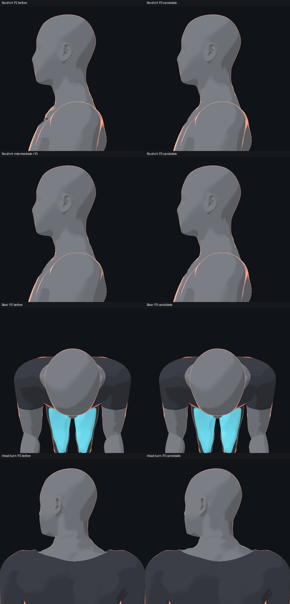

# Body v3 collar: P3 review

The neck root and torso are joined in one indexed surface, retaining the
visible collar outline and the effective v3 skeleton. The internal garment
refinement subdivides six triangles and adds seven vertices, each offset by
0.2 mm; all original garment vertices and boundary positions are retained.
Weights and toon vertex textures are interpolated for the new vertices.



The coordinating reviewer inspected the three neck extremes, side and back
views without the shirt, and the two squat poses and bear hold. The original
neck-root step, the r10 faint line and the new shoulder fragments are no longer
visible in the reviewed final images. Natural jaw and neck shading remains.
The intermediate r10 comparison is explicitly labelled; it is not the
original P2 baseline.

The closed interfaces have 200 neck and 96 torso shared edges; P2's 162 head
edges remain shared. Their maximum position and normal difference is zero
because each interface uses the same vertex. This is a welded-topology
measurement, not the former nearest-surface measurement of two separate
meshes. All three synthetic neck extremes have no bridge face opposed to its
shading normal; the maximum face-to-shading-normal angle is 52.97 degrees.

At the deep and half-squat frames and the bear hold, all 21,125 torso vertices
and the 5,588 collar vertices selected in rest have zero position difference
from the original torso. Its inverse bind matrices are unchanged. The
unchanged P2 head vertices differ by at most about 0.000060 mm after binding
space conversion. Earlier candidates with a torso binding error were rejected.

Theme and neck-highlight controls produce visible changes. The final entry's
18 action images are byte-identical to the reviewed candidate. Name-keyed
lifecycle checks retain the same 52 bone objects, parents, local matrices and
source inverse binds. Detach restores the original geometry and materials and
disposes the temporary meshes' geometry and materials. Page errors are zero.

The opt-in entry is
[`training-human-v3-collar-r1`](../../drill-anim/models/training-human-v3-collar-r1/README.md).
It composes P2, the shared collar surface and the internal garment refinement.
Its verifier normalizes text CRLF to LF and checks binary assets unchanged.
The deterministic build assembles a new overlay from the frozen candidate
data; it does not claim to replay the original editing process.

```text
node drill-anim/models/training-human-v3-collar-r1/verify.mjs
node tools/body-v3/collar-v3-r1/build.mjs <new-overlay-directory>
node tools/body-v3/collar-weld-r1/verify-v3-collar-integration-r1.mjs <new-output-directory>
node tools/body-v3/collar-v3-r1/verify-lifecycle-r2.mjs <new-report-path>
```

This closes P3 for the reviewed poses and configuration. It is an experimental
local repair, not a full baked GLB or all-motion/device acceptance. Integration
with L1, L2, P1 and the remaining joint corrections is separate work.
