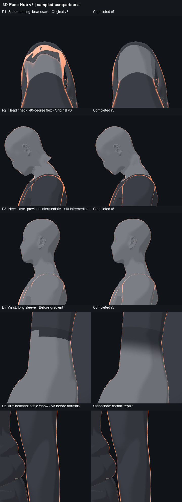

# 身体 v3 已完成修复的组合入口复核 r1

`training-human-v3-completed-r5` 是 P1 脚踝、P2 头颈、P3 领口、L1 手腕渐变和 L2 法线修复的组合候选。2026-10-27 的本地浏览器采样和画面复核支持作为统一基线继续集成；这不是全动作、设备或发布验收。冻结清单中的 `experimental-candidate` 和历史说明保留原状，本记录描述此后的复测结果。



图中 P3 左图是 r10 **中间版本**，用于观察浅线的变化；L2 最后一行是独立法线修复的前后图，不冒充组合入口截图。其余右图来自实际 r5 组合入口。P1 的四姿态十个同机位图也经过复核：r17 与 r5 的几何和外观支持组合基线，但由于叠加 L2 法线，亮度并非逐像素相同。

## 入口与边界

调用 `drill-anim/models/training-human-v3-completed-r5/loader.mjs` 的 `boot`，再在同一页面只调用一次 `applyV3`。入口先初始化 P2，再暂时关闭 torso、limbs、hands 并复位；在现有骨架上安装 P1，恢复完整 profile 后依次安装手腕渐变、L2 piece 法线、P3 共享领口、衣领内部细化和法线／纹理同步。它不重新初始化人体或替换骨架。

组合使用 `collar-weld-r26` 与 `collar-garment-refine-r7` 处理组合时局部遮挡：颈根局部调整、衣领内部 105 个原顶点平滑调整及新增内点，原衣领边界保持固定。P3 已冻结的独立版本保持不变；自然颈部和下颌明暗保留。

P4 髋膝、P5 动作肩部修正均不在此入口内。它也不是完整烘焙 GLB，不包含动作迁移或媒体、catalog 版本升级。

## 已采样结果

| 项目 | 组合复测与范围 |
| --- | --- |
| P1 | 静止、深蹲、熊爬和坐姿前屈各采样一帧。56 对来源接缝的最大间隙为 0.000052 mm，按骨名比较权重差为 0。身体和鞋位置与 r17 参考相同，limbs 最大位置差 0.000075 mm；四网格索引与采样骨骼矩阵一致。同机位十图的亮度有差异，已单独目视复核。详见 [P1 复核](ankle-repair-r1.md)：旧最近顶点代理的熊爬 63 个警告、最大 9.375 mm 仍保留，不能当作确认穿模，也不能宣称所有姿态碰撞均已解决。 |
| P2 | 组合入口采样低头 40°、仰头 35°、转头 65°以及侧／后视。头部接缝 162 条、颈部 200 条、躯干 96 条边由共享索引连接；共享索引接缝间隙为 0 是拓扑性质，不是两个独立网格的测距。原骨架 52 骨、30 根手指骨的对象及父级引用保持，身体和手的逆绑定矩阵未变。 |
| P3 | 无上衣侧／后视、三颈姿态、熊爬及静止肩部采样图与已复核的 r4 对应图逐像素一致；明显浅线和灰片在复核视图中消除，保留自然明暗。原衣领外边界保持；这不等于覆盖全部动作的穿模证明。 |
| L1 | 左右手长袖、短袖都做同几何切换与直接控制采样；安装 P3 前后四张手腕图像一致。渐变走手部材质路径，原始效果及修复对照见组合图。 |
| L2 | P3 之外的 21,029 个 torso 顶点法线分量与安装 P3 前的 L2 结果一致，limbs、hands 法线缓冲差异为 0；96 点领口环保留 P3 法线。静止肩肘及开关切换已采样；不能据此推断所有姿态的亮斑都已排除。 |

实际 toon 主题和高亮的正对照分别观察到主题 36,144、颈部高亮 107、腿部高亮 8,813 个像素变化（RGB 差大于 5，限各自测试区域）。真实 shader 编译后，测试临时更改源 `uV2pT` 的一个纹素，源纹理版本由 4 变到 6，精细网格的纹理副本同步并在测试后恢复；同时检查 `uVT`、`uVR`、`uMMT`、`uV2pT` 的同步路径。该项不声称对 GPU 纹理做了逐像素回读。

## 生命周期

`detachGeometryLayers(page)` 按逆序移除 profile 同步、衣领细化、领口和头颈片段；脚踝几何及材质、基础手臂法线、piece 法线及其 hook、手腕材质 hook 会保留到页面销毁，属于**部分卸载**。若安装失败，脚踝等修改可能已部分生效；应丢弃页面并以新页面重试，不能在原页面重复初始化。

## 复现

在具备项目依赖及配置好的 v3 Vite 服务的全新检出中，先验证冻结依赖，再串行运行以下浏览器采样。三个输出目录必须均不存在，路径可按本机调整；每次仅启动一路浏览器，脚本对各阶段设置 90 秒超时。r16 是几何与机位参考，r17 提供最终鞋材质截图。

```sh
node drill-anim/models/training-human-v3-completed-r5/verify.mjs
node tools/body-v3/completed-v3-r1/check-r5.mjs
node tools/body-v3/completed-v3-r1/test-profile-normal-sync-r4.mjs
node tools/body-v3/ankle-r17/test-integrated-material-r4.mjs
node tools/body-v3/ankle-r16/compare-four-r1.mjs NEW_R16_REF
node tools/body-v3/ankle-r17/compare-r17-r1.mjs NEW_R17_SHOTS NEW_R16_REF
node tools/body-v3/completed-v3-r1/verify-visual-r5.mjs NEW_R5_OUTPUT NEW_R16_REF NEW_R17_SHOTS
```

`verify.mjs` 递归核验组合及其已冻结依赖：文本按 UTF-8 的 CRLF→LF 规范化计算 SHA-256，GLB 按原始字节计算。浏览器报告为采样数据，图片仍须人工检查。构建诊断脚本还依赖先前采集的静止／动作几何与中间数据；它们的存在和用途不等于以上命令能从零重建全部原始实验数据。
