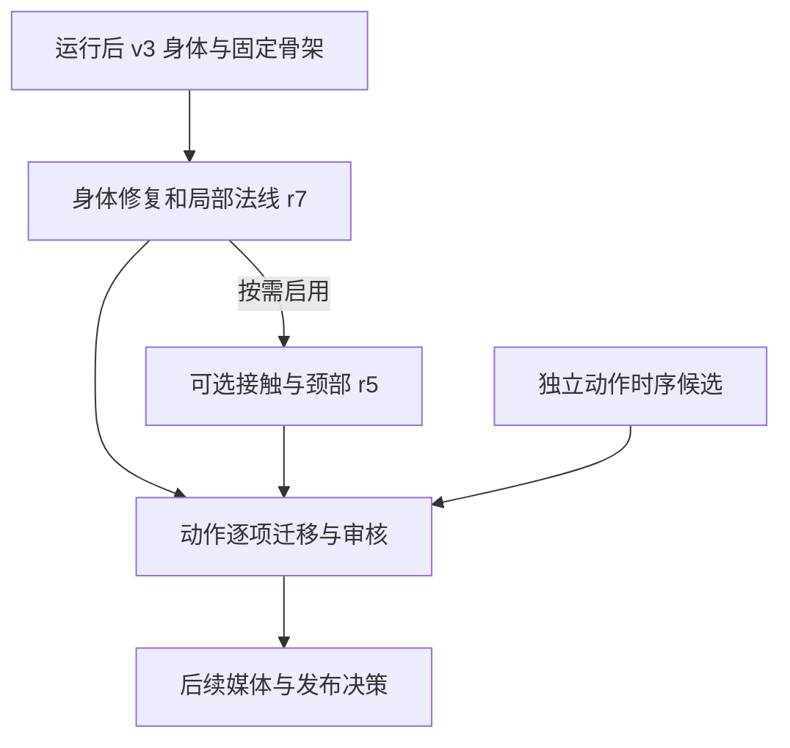

# 身体 v3 的设计与优化决策 r1

记录日期：2026-10-28。本文解释已采纳方案的原因与边界；
精确数值、同机位图片和历史实验状态以所链接的验收记录为准。
身体 r7 的网页看样已经由用户接受；此后可选接触层和动作时序分别进行局部复测，不能把两者混成一次全库验收。

## 一、把变化分层，才能知道问题来自哪里

身体形状、骨架、动作求解、时序、照明和素材发布解决的是不同问题。
骨骼或绑定变化会改变动作目标和蒙皮，动作时序会影响演示剂量，法线和材质则可能改变画面而不移动任何顶点。
将它们分开版本化，才能比较同一姿态前后的真实几何和外观，也能保留旧动作及已冻结版本的复现能力。

图中箭头表示依赖或后续工作，不表示下游已经发布；时序候选独立于身体形状，复测时再显式组合。
[身体组合复核](completed-repairs-r1.md)记录 P1–P3、L1、L2 的组合；
[肩部复核](shoulder-repair-r1.md)和[髋膝复核](p4-repair-r1.md)说明 P5、P4 怎样继续叠加。

用户确认以**当前运行后的 v3 骨架**为基准：52 根骨中包含左右手 30 根指骨。
身体修复和新接触层保留骨对象、父子关系及绑定，不通过增加骨骼或重新初始化来掩盖变形。
颜色、主题与肌群高亮也属于需要保留的行为，不应靠全局关闭轮廓光来消除局部瑕疵。

## 二、身体各处为什么这样修

### P1 脚踝与鞋口

深蹲、熊爬等姿态的鞋口鼓出涉及鞋与皮肤的实际形状、蒙皮接缝及局部着色。
方案在独立版本中调整脚踝形状和权重，同步按来源识别的接缝；鞋内侧只对相关鞋材质启用可见的内表面。
局部前向面法线冲突的着色处理保留真正背面的保护与原本高亮，而非改变全部衣物材质。

四个采样姿态的固定选区中，鞋／皮肤 FCL 接触对从原始各侧 116–208 对降为 0；接缝误差约万分之一毫米量级。
这是固定区域的三角面结果，不能证明封闭实体无包含或所有动作均不碰撞。
旧最近点代理在熊爬仍报告 63 个警告、最大 9.375 mm：通过最近三角面、射线和开放边限制分析解释其意义，数字没有被改成通过。
详见[脚踝记录及对照](ankle-repair-r1.md)。

### P2 头颈与 P3 领口

头颈大角度裂口的处理沿用手腕过渡缝合的思路，建立约 25 mm 的过渡并连接拓扑，
而不是只把两层未连接网格推到一起。低头、仰头和转头的采样对照用于检查裂口及原骨架保持。
共享索引的 gap 为 0 是拓扑事实，不是对两层独立网格再测得的距离。

Blender 场景中按来源 ID 对头颈接缝实际焊接，形成 162 条共享边；
但 GLB 导出的两套材质 primitive 在重新导入时会拆开接缝顶点，运行时 toon shader 也不能由该 GLB 直接保存。
因此头颈片段加载时按原顶点 ID 恢复共享边，同时保留两套材质并复用现有骨对象。
[焊接清单](../../drill-anim/models/head-neck-weld-r2/manifest.json)及[头颈入口说明](../../drill-anim/models/training-human-v3-head-neck-r2/README.md)记录来源、验证与限制；
[拓扑构建脚本](../../tools/body-v3/head-neck-topological-r1/build_topology.py)保留可复现的来源对应关系，但需要其记录的输入数据。
该过程交付的是头颈片段与运行时恢复，不表示整身 GLB 已经烘焙或独立发布。

领口与颈根通过共享连接及局部细化处理重叠，保持衣领外轮廓，避免为了消除浅线而改变整片衣服。
头颈和衣领分材质的纹理包装需要隔离，同时继续同步主题、高亮和纹理变化；
自然下颌阴影与颈部明暗应保留。相关拓扑、采样和限制见[组合复核](completed-repairs-r1.md)。

### P4 髋膝：把可见碎带与几何接触分开

最初深蹲图中的橙黑碎带不能直接等同于可见穿模。
后续用局部面身份、不同机位及着色对照定位原因，并按用户确认的口径保留自然膝窝接触、连续轮廓光和暗折。
双膝根据姿态重算法线并在局部淡出；髋部对来源顶点使用固定局部遮罩和有上限的法线旋转。
这些层不改变位置或蒙皮，只修复采样视图中的照明碎带，不声称三角面零相交。

旧的最近骨线距离比 p5 在深蹲中会受到另一根骨靠近影响；
所属骨刚性移动的对照中，所属骨距离比保持 1，t=3 的旧两轴 p5 仍只有约 0.322。
因此它不能单独判定可见塌陷，但旧结果没有删除：t=1 左／右为 0.3622／0.3518，t=3 为 0.1876／0.1889。
固定扩展膝区仍有接触对，先前约 3.480 mm 的局部交线也如实保留；
FCL 对数既不等于可见缺陷数量，也不是全身碰撞证明。[P4 记录](p4-repair-r1.md)保存原数值和三姿态双侧视图。

髋膝法线的门控依据骨骼相对姿态，静止时关闭，接缝区域避免制造新断层。
原位置计算使用的法线、呼吸和下沉行为仍保留；法线目标与 P5 所需顶点的关系经过独立检查。
协调复核者检查的 18 张最终髋膝视图属于有限采样，并不等于所有深蹲及所有照明环境通过。

### P5 肩部

熊爬肩部拉伸采用左右局部相对 morph 和相对姿态门控，既改善局部变形，也避免整个人刚体转动就触发修正。
腋侧局部法线根据几何变化旋转原设计法线并平滑过渡；复核的熊爬采样保留自然折边，未见新增大片灰片或悬空碎片。
该局部方案针对已定位的端点调整法线，所对照的 CPU 位置、骨矩阵及无光顶点 ID 掩码保持一致；全局 rim 保持启用。

60 个训练点和 60 个留出中点是离线几何与门控证据，并非 120 帧完整 GPU 实拍。
熊爬留出中点的双肩骨距离比 p95 分别为 1.394252、1.385698；未见动作的门控泛化仍待检查。
实际组合入口另检查熊爬几个阶段与其他采样姿态，详见[肩部记录](shoulder-repair-r1.md)。

### L1 手腕颜色与 L2 手臂法线

手部材质的颜色路径与四肢不同，直接调整四肢 shader 无法保证袖口到手的过渡。
手腕方案在手的材质路径上做约 25 mm 的颜色渐变，分别复核左右手、长袖和短袖；不替换手部源资产。

拉长后的手臂亮点涉及法线而非必然需要改形状。
重算与同步相应片段和接缝法线后，原 v3 同入口的外轮廓断续亮点变得连贯；
腋下沿遮挡边的连续自然 rim 被保留。组合入口与原 v3 的对照范围不同，不能把两种入口互作修复前后。
原入口的静止肩肘图、连通腋下遮挡边的证据见[手臂法线记录](normal-repair-r1.md)；组合采样及范围见[组合复核](completed-repairs-r1.md)。

## 三、把有效动作优化移植到新身体

旧身体专用的毫米偏移、旧手和颈部入口不能因文件能合并就直接继承到 r7 身体。
PR #18 中与身体无关的欠约束和代理接触失败原因仍成立：侧抬腿克隆后移除无独立目标的 `pz` 求解及旧 touch walker，
保留动作轨迹和 QA。五个时间点的冷／热分支得到一致结果；真实掌心贴腰和整套动作外观仍待后续迁移。
详见[侧抬腿采纳记录](../reviews/pr17-22-adoption-20261028/pr18-adoption-r2.md)。

PR #21 保留掌面拟合和颈部通道设计，但以 r7 为底座另建 opt-in `training-human-v3-contact / 0.1.0-r5`。
左右手分别使用各自实际网格、指骨支点和掌面拟合；右手四元数按冻结 setter 的镜像规则反向编码。
两侧私有手姿由包装器映射回公开的 `palm-floor` 语义，避免修改旧 setter 或骨架。

整体手指统计曾掩盖左小指悬空：r4 的该指腹 P10 为 6.282 mm，未达到 4 mm 标准。
r5 给左小指末节增加单独目标并保留防穿透惩罚；真实蒙皮后采样为 1.806 mm。
验收逐侧检查掌面、掌根和五根指腹各区：P10≤4 mm、各区有规定范围内接触点，整手没有低于 −2 mm 的点。
这是三个撑地时刻的结果，不自动覆盖其他朝向、道具握持或连续播放，见[接触记录](../reviews/pr17-22-adoption-20261028/pr21-adoption-r1.md)。

PR #19 的 8 秒时序优化与身体更新是两件事：保速并增加休息、或减少演示次数的四项被独立采纳。
其中 `quadriceps-C-r2` 保留处方要求的顶端 2 秒；`chest-B-r2`、`serratus-A-r2` 和 `triceps-A-r2` 保留原运动速度。
其余八项涉及过短停留、加快节奏、未确定的换侧或演示与计时处方的边界，暂缓逐项审查而非一概视为过时。
四项的 240 帧轨道映射及 51 张 r7 采样检查、既有可达范围告警均记录在[时序采纳](../reviews/pr17-22-adoption-20261028/pr19-adoption-r2.md)。

## 四、生命周期、证据和后续边界

r7 和 r5 均先递归核验冻结清单，再在新页面初始化一次；r5 验证模型配置、有限输入和静止骨架后安装受控包装。
卸载按接触层、姿态预处理、髋膝及底座层的相反顺序执行，恢复本层手姿与钩子。
部分脚踝、法线和材质 hook 与页面同寿命；失败后或需要完整重置时销毁页面，不能在同一页面重复初始化。

可复核入口和脚本见 [r7 髋膝记录](p4-repair-r1.md)、[接触复测](../reviews/pr17-22-adoption-20261028/pr21-adoption-r1.md)
及[时序复测](../reviews/pr17-22-adoption-20261028/pr19-adoption-r2.md)；浏览器预览应使用项目已配置服务、新输出目录和单路渲染。
清单验签、离线数值、GPU 采样、人工看样分别说明不同范围，任何一项都不能替代其他项。

用户接受 r7 后，身体从原混合 PR 中独立合入并标记；后续另按授权选择性采纳 PR #17–#22 的有效部分。
具体提交、原 PR 状态和未采纳内容见[身体独立集成](integration-20261028-r1.md)及[后续采纳记录](../reviews/pr17-22-adoption-20261028/adoption-record-r1.md)。
冻结 manifest 保留编制时的 pending 状态，由后续记录说明实测，不为更改文字覆盖已锁定 SHA。

**尚未做**：241 个动作逐项迁移与重定向、全部姿态和设备验证、媒体／SDK 升级及公开发布，
以及可选的整身 `flare-coach-v3.glb` 烘焙。全局生产默认仍是 v2plus；用户对 r7 的网页看样不等于这些后续阶段通过。
