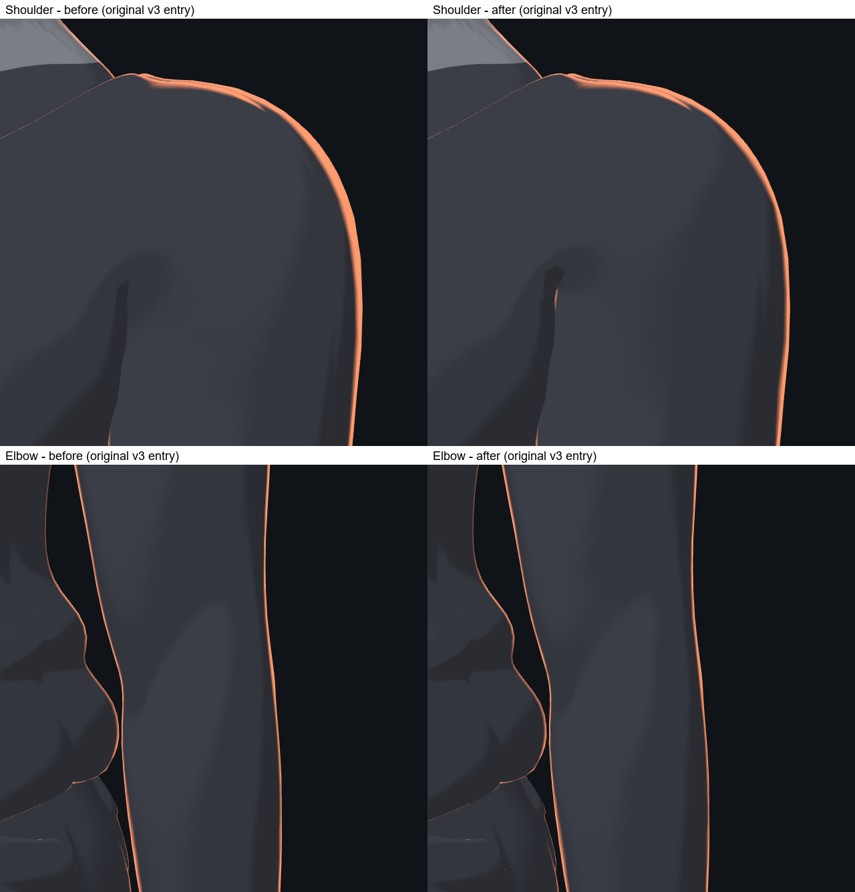

# Body v3 arm normals: L2 review

The warped arm normals are recomputed in the effective v3 rest pose and
converted back through each vertex's original skin transform. The source
positions, skin weights and skeleton are retained. The new loaders are opt-in;
the frozen v3 and v2plus sources are unchanged.



The original `v3render v3` cameras were reproduced with and without the repair.
The coordinating reviewer inspected the front, T-pose, shoulder and elbow
images: the discontinuous outer arm highlights become a continuous contour.
The narrow rim in the armpit is retained. Its 59 pixels form one connected
component along an existing occlusion edge; an independent CPU raycast finds
two layers of the same shirt at every sample. This is a natural shading edge,
not an isolated edge speck. The raycast does not reproduce GPU clipping or
shader displacement.

The base repair changes 6,569 normals, shares normals across 4,081 duplicate
vertex entries and protects 203 vertices. It does not merge their geometry.
The numerical check finds no non-finite or zero normals;
maximum unit-length error is 4.24e-8. `training-human-v3-normals-r1/loader.mjs`
reproduces the original no-outfit entry used for this review.

`training-human-v3-normals-r3/loader.mjs` additionally corrects the active
v2plus pieces and shares normals across torso, limbs and c1r2 hand seams. In
four sampled poses, seam-normal p95 falls from 4.826 degrees to at most
0.0000031 degrees; maximum position gap stays at most 0.000113 mm. These are
seam measurements, not an all-surface or all-motion collision audit. The
complete-outfit images are a separate comparison from the original-v3 image
above.

Reproduction and the exact evidence scope are recorded in
[`normals-closeout-r1.md`](../../tools/body-v3/normals-closeout-r1.md).
The numerical checks are:

```text
node tools/body-v3/verify-normals-candidates-r1.mjs
node tools/body-v3/arm-normals-r1-check.mjs
node tools/body-v3/piece-normals-r1-check.mjs
node tools/body-v3/piece-normals-r2-check.mjs
node tools/body-v3/normals-loader-r3-check.mjs
```

This closes L2's original static arm-edge criterion. Natural elbow folds are
retained. The loaders remain experimental (`reviewed:false`,
`releaseEligible:false`); this is not production, device, or 241-motion
acceptance. Composition with the other body-v3 fixes remains part of the final
integration work.
