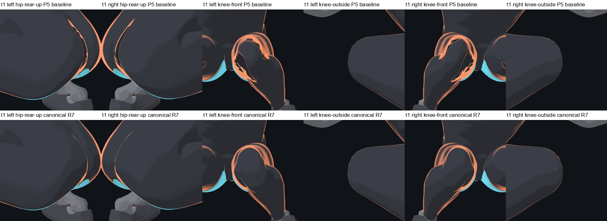
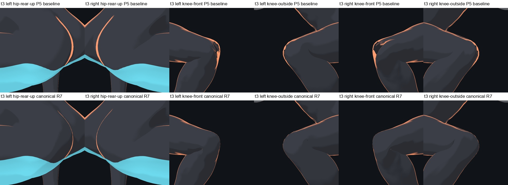
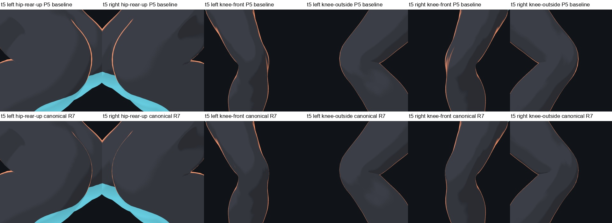

# 身体 v3 髋膝修复与七项组合入口 r1

统一入口为 `drill-anim/models/training-human-v3-completed-r7/loader.mjs`，身份是 `training-human-v3-completed / 1.0.0-r7`。它在已完成的 P1、P2、P3、P5、手腕渐变和手臂法线上增加 P4 局部姿态法线修正，只初始化一次 v3。递归依赖为 Knee Normal r1 → Shoulder Completed r3 → Completed r6；旧模型及其锁定 SHA 保留。

## 验收目标与实际外观

开哥先确认保留旧 p5 报告，改用三角面检查及外部多机位共同复核；随后明确选择“保留膝窝自然接触，继续修复可见碎带并复测”。本项因此修复可见的断续亮片，保留自然接触、连续轮廓光和膝窝暗折，不声称几何零相交。

三组图的上排为 P5 组合基线，下排为规范 r7；各列依次为双髋后外上斜、左膝前／外侧、右膝前／外侧。图像来自不读取历史 QA 文件的预览命令；18 张基线、18 张 r7 的 RGB 像素分别与原复核图完全一致。协调者检查了以下全部 18 个最终视图：最深和平行蹲位的碎亮带消失，半蹲变化较小，未见新增大片折带或悬空碎片。







`a-deep-squat-r3` 是三个静态姿势，t=1、3、5 分别采最深、平行和半蹲；这些图不冒充连续动作验证。膝机位距关节约 0.68 m，另加双髋后外上斜机位。

## 几何数据继续保留

旧 p5 是点到大腿／小腿两条骨线段的最小距离比，另一根骨靠近也会使它降低。仅随所属骨刚性移动的诊断中，点到所属骨的距离比保持 1，t=3 的两轴最近距离 p5 仍约为左 0.3224、右 0.3245。这个在归属边界不连续的对照只解释指标，不能当作修复模型；复现脚本为 `tools/body-v3/knee-corrective-probe-r1/metric_owner_audit_r1.py`。

| 姿势 | 保留的旧 p5，左／右 | 固定扩展膝区 FCL 非共享接触对，左／右 |
| --- | --- | --- |
| t=1 | 0.3622 / 0.3518 | 221 / 220 |
| t=3 | 0.1876 / 0.1889 | 211 / 218 |
| t=5 | 0.6699 / 0.6686 | 90 / 89 |

本次不改变位置和蒙皮，这些几何结果保留，包括此前定位的约 3.480 mm 局部膝交线。FCL 对数不等于可见缺陷数量，也不能证明整个身体的实体碰撞。髋部断续橙带实际由 P3 共享网格的第三套材质显示；所选上端采样面未落入有限区域的接触集，姿态法线诊断支持其着色成因。该归因不扩展为全身无相交证明。

## 两个局部法线层

双膝目标范围 4,870 点，静止膝中心 100 mm 内满强、100–140 mm 平滑淡出；接缝遮罩为零。相对静止的膝骨旋转 30–70° 平滑启用，三种蹲姿均为满强，静止为零。它重新累计姿态三角面的平滑法线，不修改原 `normal` 属性或位置数据。

髋部固定遮罩含 856 个源点，来源为两侧各 160 个确定性橙带样本所定位的 166 个种子；0–2 邻接圈满强，2–6 圈淡出，跨网格接缝保持。每点沿最小旋转方向接近姿态几何法线，每次最多 30°，再乘遮罩和骨盆／股骨相对旋转门控。参与计算的 1,016 点、1,870 面与 P5 非零位置及法线目标均无交集。

两层只改变照明法线 varying。原 `objectNormal` 在位置计算前恢复，原 toon 呼吸和 skin 后下沉的方向保留；髋层按实际 remap 后的 uVR/uMMT 重建这些位移，再计算法线。缺失或非有限输入会停用该修正。膝层对其范围内不支持的非零 sink 输入安全停用；正常基线的该区域 sink 为零。

同一个 `renderer.render` 包装在 WebGL 属性上传前更新法线并缓存姿态，髋层使用膝层的唯一受控扩展槽。初次编译在统一加载返回前完成，首次有效绘制不依赖下一帧补算。卸载顺序为髋 → 膝 → P5 → 基础几何层；脚踝、基础法线和手腕的既有 hook 仍驻留到页面销毁，因此完全重建需要新页面。

## 复测证据与边界

规范入口实测身份正确，18 张图与已审阅组合候选逐字节一致。单独启用膝层的 12 图、单独启用髋层的 6 图也分别与独立参考一致。52 骨、其中 30 根指骨的对象与父级、原位置／法线／蒙皮属性和绑定保持；三姿态原属性及骨矩阵快照一致。

静止、长短袖、profile 关闭／恢复、连续动作五次姿态切换首帧与重画、部分卸载均通过。实际高亮关闭会改变画面，恢复后图像完全还原，rim 始终为 1。非零 breath=0.08 和临时 sink=0.006 的 GPU 正反控确有位置变化，但在各自条件下法线层开／关的顶点识别图相同。独立 CPU oracle 覆盖非均匀 mesh/bind、位置和法线 morph，并能区分呼吸空间、sink 符号和重复蒙皮的错误。

原始 JSON/PNG 在本轮仓库外输出的 `knee/` 下：`completed-r7-canonical-live-r1`、`completed-r7-candidate-live-r1`、`hip-normal-local-live-r5`、`knee-normal-candidate-live-r2` 及 `delivery-preview-*`。摘要与源报告哈希见 [采样证据](evidence/p4-r7-sampled-r1.json)。冻结 manifest 的 pending/unreviewed 注记保留创建时状态，本记录说明后续复核。

以上为列出的采样验收；未迁移或逐一复核 241 个动作，未做设备或素材发布验收，可选整身 GLB 尚未烘焙。其他已完成项见 [五项组合](completed-repairs-r1.md) 和 [肩部修复](shoulder-repair-r1.md)。

## 新检出预览与校验

在仓库根目录，依照 HANDOFF 配置浏览器并启动 Vite。下面的预览不要求历史截图或原始采集目录，输出路径必须不存在；一次只运行一个浏览器。

```sh
node tools/body-v3/completed-v3-r1/preview-r7.mjs <new-before-dir> --model p5 --case squat --frames 1,3,5
node tools/body-v3/completed-v3-r1/preview-r7.mjs <new-after-dir> --case squat --frames 1,3,5
python tools/body-v3/completed-v3-r1/compare-preview-r7-r1.py <new-before-dir> <new-after-dir> <new-comparison-dir>
node -e "import('./drill-anim/models/training-human-v3-completed-r7/loader.mjs').then(async m => console.log(await m.verify()))"
node tools/body-v3/knee-normal-r1/final-kernel-test-r1.mjs
node tools/body-v3/knee-normal-r1/final-lifecycle-test-r1.mjs
node tools/body-v3/knee-normal-r1/final-extension-test-r1.mjs
node tools/body-v3/hip-normal-r1/verify-kernel-r7-oracle-r1.mjs
node tools/body-v3/hip-normal-r1/verify-kernel-r7-angles-r1.mjs
node tools/body-v3/hip-normal-r1/verify-p5-overlap-final-r1.mjs
```

预览提供图片，不自动宣告外观通过。需要历史参考的详细 GPU 冒烟脚本保留显式输入参数；遮罩重建和膝层重建也要求显式外部采集／复测报告。模型运行、递归验签和上述独立 CPU 测试不依赖未提交的中间候选目录。

推送前仍执行 `npm run -s verify`、`python drill-anim/test_portability.py`、`node drill-anim/tools/catalog.mjs --check`；不修改动作、媒体和 catalog 版本。
