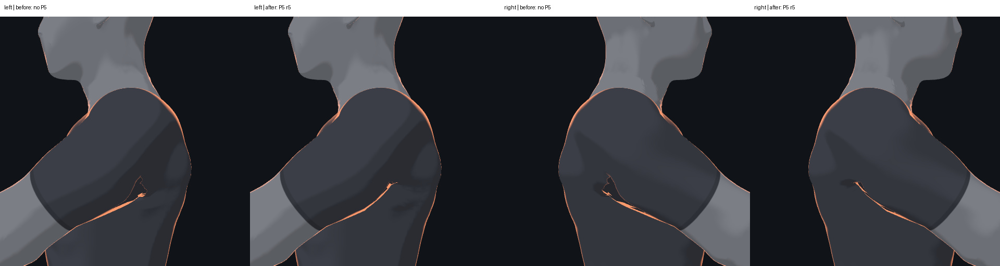
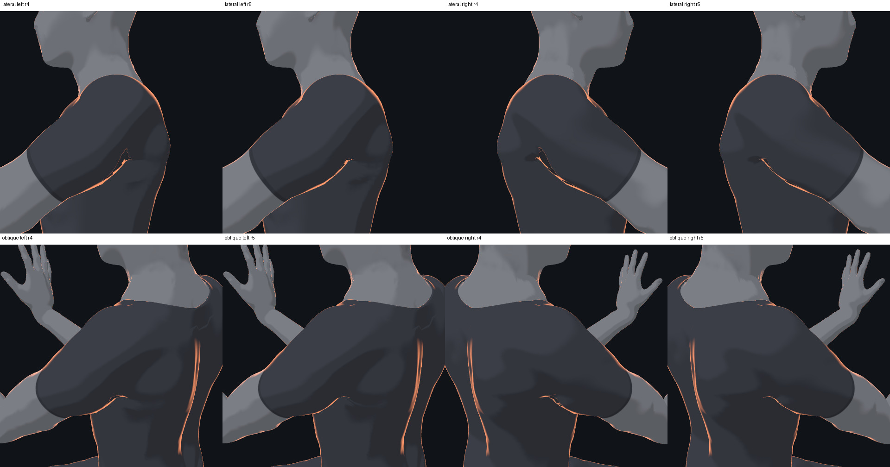

# Body v3 shoulder: r5 sampled-frame evidence

This is a review record for one experimental shoulder candidate, not a claim
that P5 or the complete body-v3 model has passed. The coordinating reviewer
accepted the local appearance in the recorded bear-plank frame. The final
combined entry, action transitions and lifecycle still require verification.

The comparison uses the same bear-plank midpoint and left/right lateral
cameras. “Before” has P5 position and normal morphs disabled; “after” has the
independent left/right shoulder correction and r5 normals at full strength.
The model is the completed-r4 P2/P3/L1/L2 entry in both cases. The after image
was captured in a separate page; the recorded zero and full torso positions
match the corresponding earlier sample exactly.

This second image is a same-page **r4 versus r5** normal comparison, including
both oblique rear views; it is not the original-before versus final image.
Individual frames are recorded under
`E:/AII-3D/codex-output/body-v3-fixes-20261027/shoulder-armpit-local-live-r5/`.

In the sampled frame, shoulder bone-distance ratio p95 was 2.0187 → 1.3403 on
the left and 2.0259 → 1.3290 on the right. The final local edit changes only
normal targets; the compared P3 and Mesh005 CPU positions and bone matrices
are identical, as are both meshes' unlit GPU vertex-ID masks in all four views.
The global rim uniform remained 1. No new large dark fragment or detached
piece was seen in the four views reviewed by the coordinating reviewer; the
continuous armpit occlusion edge remains visible.

## Cause and scope

The original orange endpoint follows a continuous torso fold. For the
thresholded lateral-view orange ROI, actual GPU mesh IDs identified the P3
shared torso; 589 left and 478 right ROI pixels were assigned to it. CPU
raycasts at those pixels hit its front-facing triangles. A subset of 96 pixels
per side covered 49 left and 44 right triangles; all belonged to the single
connected 42,048-face torso component and had no non-shared FCL intersections
with P3. Their 40 mm centroid neighborhoods had no non-shared FCL contacts
with the actually captured Mesh005 garment.
This does not rule out all collisions elsewhere or in other poses.

The original compression guard was solidly unhit at most orange pixels; no
orange pixel was a solid full hit, and antialiased mixed pixels were left
unclassified. The visible line also appeared in the isolated rim contribution.
In the same image, the GPU-encoded angle between smooth and geometric normals
had median 29.38° left and 27.39° right on orange pixels, versus 10.81° in
the neighboring non-orange region. These observations support a normal-driven
amplification of an existing fold; the isolated rim view is a diagnostic,
not a proposed global rim change.

The captured torso shader inputs had `uBreath=0` and zero `uMMT.w` values in
this frame. Independent temporary breath/sink controls produced identical
images and were restored. Reconstruction of the selected triangles from
captured skin/morph inputs differed from CPU skin positions by at most
0.000045 mm. This observation is limited to the captured torso material and
frame; it does not cover other materials or animations.

## Candidate and integration boundary

The bilateral position candidate and relative pose gate retain the existing
skeleton. A four-ring fade first applies a geometric-change rotation to the
authored normal field. The r5 tip adjustment then affects 459 local torso
normal targets around the identified endpoint, including 60 vertices whose
positions do not move; 18 target IDs are new relative to r4. Its maximum
additional normal rotation is 16.25°. The 44 shared collar/garment targets and
seven added garment-point targets are retained unchanged. The initial r4 fit
interpolated the seven added points from parent-triangle bind-normal deltas.

The experimental r5 asset is `shoulder-armpit-normal-r5.json` in the external
output directory above (SHA-256
`7454b70eb1fb711a43c0365b3a1c09394c2dcfc9b94005ef604849c2de623f4a`).
It was fitted to completed-r4 and this frame, so it must not be treated as
validated for another completed profile without checking its source geometry,
normal buffers and bindings. The packed profile must preserve the 18 extra
torso IDs and all 51 garment target rows.

The smallest experimental runtime inputs are the left/right bind-offset
tables, relative-gate configuration, captured rest skin matrices and the r5
normal asset, together with `runtime-current-r1.js` and
`install-current-normals-r1.js` in
[`tools/body-v3/shoulder-corrective-probe-r3/`](../../tools/body-v3/shoulder-corrective-probe-r3/).
`apply-armpit-normal-r5.js` was used only to compare r4 and r5 in the same page;
a fresh page can install the complete r5 asset directly. These research helpers
do not provide a validated detach or full profile-switch lifecycle. A new
integrated loader must supply and test that lifecycle rather than silently
altering frozen assets.

The local fitter and comparisons use `build-armpit-normal-r5.py` and
`armpit-live-local-r5.mjs`; the offline ray, connectivity, cloth contact,
GPU-branch and vertex-deformation evidence is in the external output
directory. These source snapshots and logs remain diagnostic records, not
production assets or proof of generalization to unseen actions.
