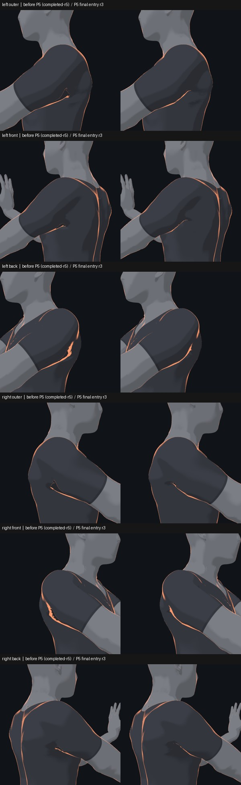

# 身体 v3 肩部修复及组合入口复核 r1

P5 组合入口是 `drill-anim/models/training-human-v3-shoulder-completed-r3/loader.mjs`，标识为 `training-human-v3-shoulder-completed / 1.0.0-r3`，底座为 `training-human-v3-completed / 1.0.0-r6`。它在 P1、P2、P3、手腕渐变和法线修复上，只初始化一次 v3，再安装双侧肩部相对 morph 和姿态门控；P4 不在此入口中。

协调复核者已检查熊爬起始、抬起、保持、回落及双肩三个机位的局部图。肩部原有变形得到缓解，明显三角尖端减弱，保留自然腋窝折边和 rim；采样视图未见新增大片灰片或悬空碎片。这是所列采样的验收，不代表全部动作、全身碰撞、设备或发布验收。历史冻结 manifest 的实验状态不改写，本记录说明其后的实测。



左图是同机位的 completed-r5 加 P5 前截图；右图是最终 r3 入口的实际截图。两者均为熊爬保持帧，分别展示左右肩外侧、前斜侧和后斜侧。r3 图与已复核的 P5 r1 组合图逐像素一致；r1、r2、r3 的位置、门控、法线及运行适配器数据相同，r3 补正消费入口身份，r2 是中间版而非最终消费入口。

## 测量和动作范围

肩部位置数据涉及左右共 3,489 个顶点，躯干法线目标 3,890 行，衣领法线目标 51 行；其中 44 行是衣领接缝、7 行是细化衣领新增点。位置修正不移动 P3 的 96 点接缝。姿态门控依据躯干与上臂、上臂与前臂的相对旋转计算左右强度；它不会驱动骨骼。

60 个训练时间点与同五个动作的 60 个留出中点共 120 个姿态使用离线 CPU 几何和相对门控验证；它们不是 120 帧完整入口 GPU 实拍，也不代表对未见动作泛化。12 个熊爬留出中点的最差骨距离比 p95 为左 1.394252、右 1.385698，低于 1.4；预测最大位移左 22.9309 mm、右 22.7892 mm。对应 [历史训练记录](../../tools/body-v3/shoulder-corrective-probe-r3/multi-pose-fit-r1.md)、[留出数据](../../tools/body-v3/shoulder-package-r1/evidence-r1/shoulder-grid-holdout-analysis-r1.json) 和 [相对门控数据](../../tools/body-v3/shoulder-package-r1/evidence-r1/shoulder-relative-gate-verify-r2.json)。训练记录保留其编写时尚未安装的状态。

上述 120 个训练／留出姿态中熊爬双侧 gate 均为 1，其余四个采样动作均为 0。合成公共刚体变化的 gate 误差最大约 3.09e-12；合成过渡并非真实动作。另在真实组合入口对熊爬起始、抬起、保持和回落各采样一帧，双侧 gate 均为 1；静止、坐姿前屈和深蹲各采样一帧，gate 均为 0。该门控不保证其他姿态不会恰好触发。

法线候选最初拟合于 completed-r4 的单个熊爬帧。组合入口相同帧对照中，P3 共享网格及 Mesh005 的 CPU 位置、法线分量和骨矩阵最大差均为 0；最终入口维持 52 骨、30 根指骨及其对象／父级引用。该局部法线来源、几何限制及原始单帧证据见 [肩部 r5 记录](shoulder-local-r5-evidence.md)。

## 领口材质与切换

原 P3 在首次绘制 full 领口时，重映射纹理会写入 P2 头颈共享的 uniform 包装对象。P5 off 双侧图因而出现 52／55 个像素差。因果诊断中，隐藏头颈网格或把其原纹理换回后，两侧 off 图均与原图逐像素一致；恢复污染后的纹理，差异重新出现。新 `collar-weld-r27` 为纹理创建独立 uniform 包装对象，同时保留实时主题／高亮引用，不修改冻结的 r26 或 P2。

在以 r6 为底座的 P5 r2 真实 GPU 测试中，off 前后、full→off→on、长短袖及直接控制恢复的双侧图均逐像素一致；P2 两材质的纹理对象、尺寸和数据哈希保持。左右三机位图与 P5 r1 对应图一致。主题和露肩 deltoid 高亮的正对照分别有 34,095、47,698 个像素变化（RGB 差大于 5），说明该采样中实时控制仍有效。r3 的运行资产和适配器与 r2 逐字节一致，另外以真实入口六张图和返回身份做过冒烟。

## 使用和复现

先调用 r3 的 `boot`，在同一页面只调用一次 `applyV3`。其 `verify()` 递归验证 completed-r6、r5 及冻结依赖，并核对 r6 manifest SHA；文本按 UTF-8 CRLF→LF 规范化计算 SHA-256。P5 的相对门控和法线资源随入口存于仓库，运行时不依赖本机输出目录。

```sh
node -e "import('./drill-anim/models/training-human-v3-shoulder-completed-r3/loader.mjs').then(async m => console.log(await m.verify()))"
node tools/body-v3/shoulder-package-r1/test-lifecycle-r1.mjs
node tools/body-v3/shoulder-package-r1/preview-r3.mjs <new-output-directory> --frames 0.1,0.65,2,3.6
node tools/body-v3/completed-v3-r1/test-collar-uniform-r1.mjs <captured-rest-v3.json> <new-report.json>
node tools/body-v3/shoulder-package-r1/verify-loader-r3.mjs <new-output-directory> <saved-r1-visual-directory>
node tools/body-v3/shoulder-package-r1/verify-switch-gpu-r9.mjs <new-output-directory> <saved-r1-visual-directory>
node tools/body-v3/shoulder-package-r1/verify-candidate-r3.mjs <new-output-directory> <saved-r4-zero.json>
```

前两项可在仓库依赖就绪后离线运行；`preview-r3.mjs` 在配置好的 v3 Vite 服务上直接生成最终入口的选帧预览，不需要历史参考图，且不将预览冒充比较验收。领口测试需要此前采集的静止网格 JSON，图像冒烟和 GPU 切换诊断还需要已保存的 r1 参考 PNG，四帧对照需要保存的 r4 同帧零强度 JSON。切换诊断保留各项比较结果供检查，不以进程退出码代替检查 `comparisons`。浏览器采样一次只用一路，保留阶段超时，图像仍需人工检查。原始训练与拟合中间数据在本机归档；打包输入的历史绝对路径不作为运行时依赖。

`detachGeometryLayers(page)` 先移除 P5 自己的 morph 和回调，再逆序卸载底座可恢复的几何层。脚踝几何／材质、基础和 piece 法线、手腕材质 hook 仍驻留到页面销毁，因此这仍是**部分卸载**；失败后或需要重新初始化时应使用新页面。
