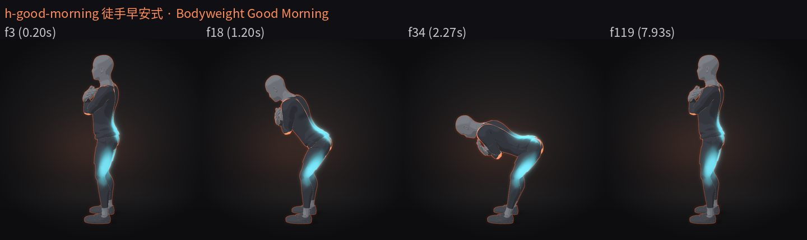
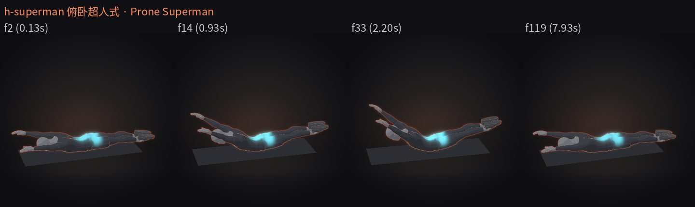
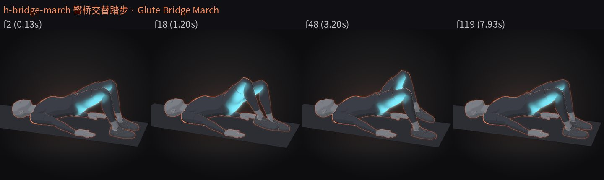
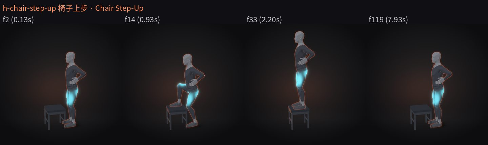

# 居家徒手后链 / 腿 4 个（无器械 + 椅子）· 2026-10-18

分支 `drill/home-posterior-chain`（PR #6），叠在 `drill/home-small-equipment`（PR #5，`be80d06`，未合并）之上，**请在 PR #5 之后合并**。4 个新 spec 都用 `training-human-v2`、`alignClavicles: false`、15 fps × 8 s（120 帧）。本文档的 QA 来自沙盒快速渲染（`DRILL_PR=0.75`、`themes/glow-soft.json`、SwiftShader），**不是成片**；成片请 Windows 4080 主线按 §5 渲染。

## 1. 动作清单

| # | id | 中文名 | English | 目标肌群（highlight.groups） | 器械/场景 | 节奏 |
|---|---|---|---|---|---|---|
| 1 | `h-good-morning` | 徒手早安式 | Bodyweight Good Morning | 腘绳肌+竖脊肌（`hamstrings`, `erectors`） | 无（双手交叉抱胸） | 2 次 / 8 s：1.8 s 下 · 0.4 s 停 · 1.4 s 起 |
| 2 | `h-superman` | 俯卧超人式 | Prone Superman | 竖脊肌+臀大肌（`erectors`, `glute-max`） | 垫 | 2 次 / 8 s：1.2 s 起 · 1.5 s 停 · 1.0 s 落 |
| 3 | `h-bridge-march` | 臀桥交替踏步 | Glute Bridge March | 臀大肌+腘绳肌（`glute-max`, `hamstrings`） | 垫 | 右、左、右、左 / 8 s，每步 0.7 s 抬 · 0.5 s 停 · 0.6 s 落 |
| 4 | `h-chair-step-up` | 椅子上步 | Chair Step-Up | 股四头肌+臀大肌（`quadriceps`, `glute-max`） | 无靠背椅（`chair`, `back: 0`），座高 45 cm | 2 次 / 8 s，第 1 次右腿领步，第 2 次左腿领步 |

SHA-256 已登记在 `drill-anim/data/home-pr-candidates.json`（PR #6，sourceCommit `33af421`），`node drill-anim/verify.mjs` 通过。

## 2. 逐个 QA

指标：`drill.py qa` 对全部 120 帧；道具闪烁 `propscan` 也对全部 120 帧。目视：预览帧 + 全片逐帧条（每 6–15 帧一张，原生 15 fps 帧号），首帧 0 与末帧 119 并排核对循环；下表“目视帧”是关键帧条（`keyFrames` + 末帧）的帧号。
4 个全部：`pass=True`、求解器警告 0 帧、出画 0 帧、膝/肘无反折、propscan 0 热点 0 坏帧。“自碰”列是全片最近的两段身体及间隙（≥ 0 即未穿插）。

| id | 结论 | 目视帧 | 最低顶点 mm | 钉住漂移 mm | 手部穿插检测最小有符号距 mm（99 = 封顶） | 自碰最近 | 伸直最小角 | 髋屈范围 ° | 备注 |
|---|---|---|---|---|---|---|---|---|---|
| `h-good-morning` | ✅ 保留 | f3, f18, f34, f119 | −0.0 | 双脚 ≤ 0.46 | 1.32（左手离右上臂） | handL\|upperArmR 36.5 mm | — | 12.6–106.3 | 躯干最低约比水平高 15°；膝软屈 148–162° |
| `h-superman` | ✅ 保留 | f2, f14, f33, f119 | 0.1 | —（无支撑钉） | 99 | thighL\|shinR 49 mm | 肘 175.2° / 膝 173.4° | −17.6 – −0.5（伸髋 ≈17°） | 骨盆和腹部始终贴垫，腰伸 6→22° |
| `h-bridge-march` | ✅ 保留 | f2, f18, f48, f119 | −0.0 | 双掌 ≤ 0.29，支撑脚 ≤ 0.46 | 99 | head\|upperArmL 55 mm | —（左肘 163°，右肘 174°） | −9.7 – 15.8 | 第 0 帧即保持中的臀桥；抬脚 9 cm、向臀部收 6 cm；骨盆全程不动 |
| `h-chair-step-up` | ✅ 保留 | f2, f14, f33, f119 | −0.1 | 地面上的双脚 ≤ 0.46 | 1.64（手扶髋，掌与躯干间隙 1.6–3.3 mm） | head\|upperArmL 55 mm | — | 12.9–122.8 | 椅面上的脚：踝 y 恒 0.536、z 恒 0.34（不滑），鞋底离座面 2 mm（不陷） |

关键帧条：`docs/home-posterior-chain-2026-10-18/<id>.jpg`。

### 逐个说明

- **h-good-morning**：起初按“双手放脑后”做，手掌落在头顶前方、肘朝前，手网格贴不到刚性头部后侧，改为任务允许的**双手交叉抱胸**（erectors-C / quadriceps-A 的掌位）。没有用 `touch` 吸附：带 bisect 吸附的版本在 training-human-v2 页面上 >75 s 出不了第一帧，去掉后掌心离胸约 1–5 mm。下到底髋屈 106°，膝 157°；平背，腰弯 0。
- **h-superman**：手臂按 w-prone-swimmer 的胸坐标几何（双臂过头、略宽于肩、掌心向下），腿是两条直腿绕髋后伸；腿长按真实骨长缩 0.15%，否则踝目标被 IK 截断（第一版缩 0.8% 让膝弯到 165°，已改）。第一版构图宽 900 时平趴姿的指尖碰左边缘，改 `frame.width` 780。
- **h-bridge-march**：躯干直接用 h-bridge-overhead 起桥顶点的几何（桥高 = 那个动作的顶点）。手掌朝下放身体两侧并钉在垫上（没有用手放腹部 + touch，那个组合以前让浏览器崩溃）。右掌比左掌往脚的方向多 5 mm：手掌在 0 时右肘 163°，而 qa 的“肘反折”判据按站姿 +Z 算，仰卧时右臂必然被判成反折；肘 ≥ 170° 时不判，左肘 163° 的方向判据是正常的。
- **h-chair-step-up**：用无靠背椅（`back: 0` = 凳子），座面前沿朝人。所有脚都是 floor 模式的脚，座面上的脚用 `lift` = 座高 + 2 mm，所以鞋底是平的、不陷、不滑。领步脚先抬高再前移越过座面前沿；后脚在发力时先踮脚（脚尖不动，踝随 pitch 前移）再离地跟上；下时后脚先落地，领步脚再下。双手扶髋（不吸附），掌心离髋 1.6–3.3 mm，抬到 123° 的领步大腿与手不穿插。构图放在“站上椅面”的最高姿态（`stillAt: 2.2`），因为按地面站姿放置时站上椅面会把头切出画面。

## 3. 放弃 / 改做

- 4 个都保留，没有动用备选（h-reverse-superman 俯卧双腿后抬、h-donkey-kick 四足驴踢未做）。
- h-good-morning 的手位由“手放脑后”改为“双手交叉抱胸”（原因见上）。

## 4. 引擎笔记（给后来做 spec 的人）

- **`full.sh` 带 `--keep` 时 `c/place.json` 会沿用上一次预览的构图**：改了 `frame` 之后只重渲不会生效（h-superman 第二次全渲仍出画 25 帧）。要么删掉 `/tmp/.../<id>/c/`，要么重新合成（本批用 `recomp.sh`：删 `c/` → `lib/comp.py` → encode）。
- **floor 模式的脚可以站在道具上**：`lift` 就是鞋底最低点离地高度，`pitch` 后再按最低点放平；座面上的脚用 `lift = 座高 + 2 mm` 即可平放不陷。踮脚时脚尖要钉住，就把 `at` 的 z 加 `0.16 − (−0.075·sin p + 0.16·cos p)`（同 h-reverse-lunge）。
- **qa 的肘/膝方向判据按站姿 +Z**：仰卧时侧放的手臂只要肘 < 170° 就可能被判“肘反折”（左右不对称），把肘拉到 ≥ 170° 可避开。
- **胸坐标系的 `touch` 吸附在 training-human-v2 上可能卡住**：交叉抱胸 + bisect 吸附 >75 s 不出第一帧；不吸附、把掌心放在表面外 1 cm 左右更稳。

## 5. 渲染请求（Windows 4080 主线）

| id | theme | pr | 帧数 |
|---|---|---|---|
| `h-good-morning` | themes/glow-soft.json | --pr 2 | 240 |
| `h-superman` | themes/glow-soft.json | --pr 2 | 240 |
| `h-bridge-march` | themes/glow-soft.json | --pr 2 | 240 |
| `h-chair-step-up` | themes/glow-soft.json | --pr 2 | 240 |

240 帧 = 发布 30 fps × 8 s；spec 原生是 15 fps × 8 s（120 帧），发布片帧号 ≠ spec 帧号。
