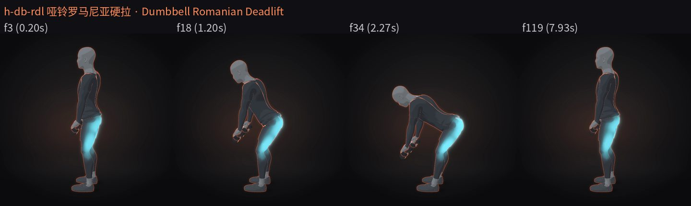
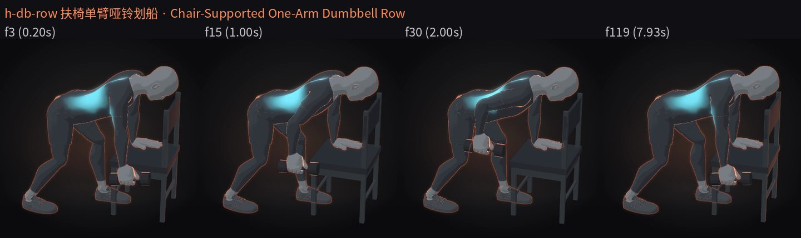
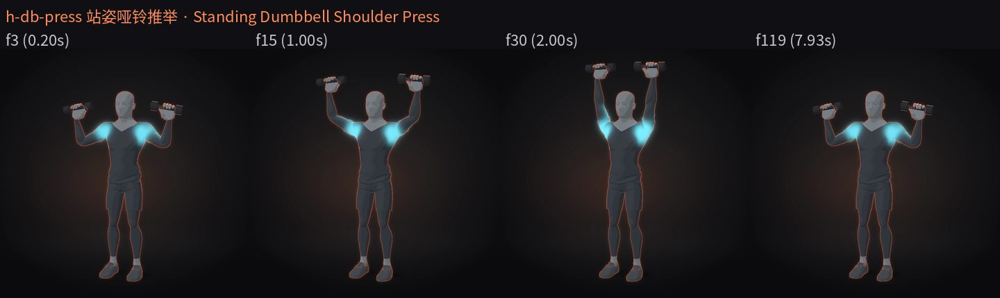
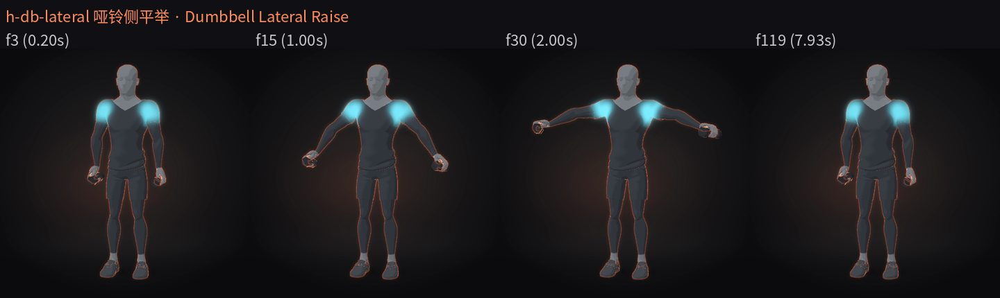
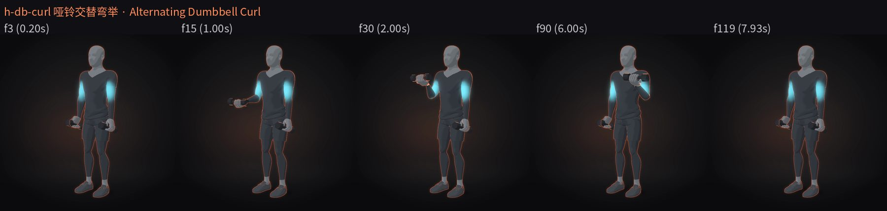
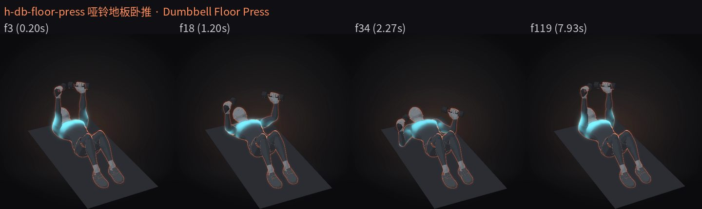
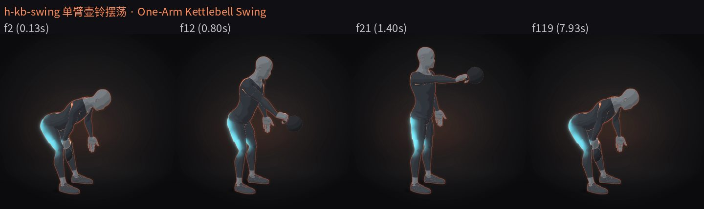
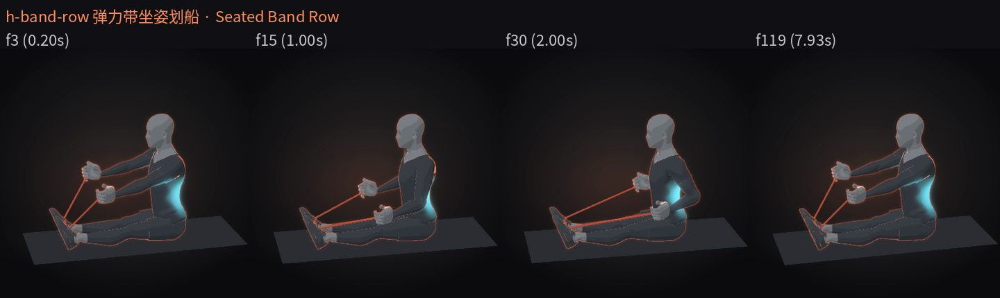
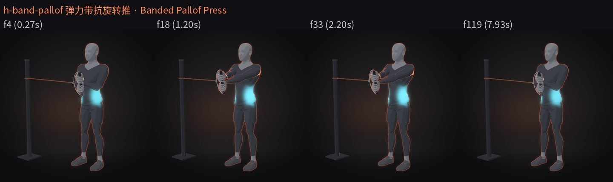
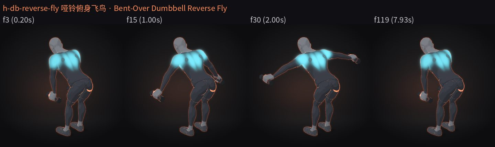

# 居家小器械力量 10 个（哑铃 / 壶铃 / 弹力带）· 2026-10-18

分支 `drill/home-small-equipment`（基于 main `1783dcc`）。10 个新 spec 都用 `training-human-v2`、15 fps × 8 s（120 帧），2 次 / 8 s。本文档的 QA 来自沙盒快速渲染（`DRILL_PR=0.75`、`themes/glow-soft.json`、SwiftShader），**不是成片**；成片请 Windows 4080 主线按 §5 渲染。

## 1. 动作清单

| # | id | 中文名 | English | 目标肌群 | 器械 |
|---|---|---|---|---|---|
| 1 | `h-db-rdl` | 哑铃罗马尼亚硬拉 | Dumbbell Romanian Deadlift | 腘绳肌+臀大肌 | 双哑铃 |
| 2 | `h-db-row` | 扶椅单臂哑铃划船 | Chair-Supported One-Arm Dumbbell Row | 背阔肌+斜方肌中下部·菱形肌（右侧） | 椅子+单哑铃 |
| 3 | `h-db-press` | 站姿哑铃推举 | Standing Dumbbell Shoulder Press | 三角肌+肱三头肌 | 双哑铃 |
| 4 | `h-db-lateral` | 哑铃侧平举 | Dumbbell Lateral Raise | 三角肌 | 双哑铃 |
| 5 | `h-db-curl` | 哑铃交替弯举 | Alternating Dumbbell Curl | 肱二头肌 | 双哑铃 |
| 6 | `h-db-floor-press` | 哑铃地板卧推 | Dumbbell Floor Press | 胸大肌+肱三头肌 | 垫+双哑铃 |
| 7 | `h-kb-swing` | 单臂壶铃摆荡 | One-Arm Kettlebell Swing | 臀大肌+腘绳肌 | 壶铃 |
| 8 | `h-band-row` | 弹力带坐姿划船 | Seated Band Row | 背阔肌+斜方肌中下部·菱形肌 | 垫+弹力带 |
| 9 | `h-band-pallof` | 弹力带抗旋转推 | Banded Pallof Press | 腹斜肌 | 弹力带+立柱锚点+单柄 |
| 10 | `h-db-reverse-fly` | 哑铃俯身飞鸟 | Bent-Over Dumbbell Reverse Fly | 三角肌（后束）+斜方肌中下部·菱形肌 | 双哑铃 |

SHA-256 已登记在 `drill-anim/data/home-pr-candidates.json`（PR #5，sourceCommit `8754eac`），`node drill-anim/verify.mjs` 通过。

## 2. 逐个 QA

指标：`drill.py qa` 对全部 120 帧；道具闪烁 `propscan` 也对全部 120 帧。目视：关键帧条（下表“目视帧”，原生 15 fps 帧号）+ 全片 GIF/MP4 过一遍。
所有动作：`pass=True`、求解器警告 0 帧、出画 0 帧、最低顶点 ≥ −0.0 mm（不穿地）、脚钉漂移 ≤ 0.46 mm、膝/肘无反折。“自碰”列是全片最近的两段身体及间隙（≥ 0 即未穿插）。

| id | 结论 | 目视帧 | 手部穿插检测最小有符号距 mm（99 = 封顶） | 自碰最近 | 伸直最小角 | 髋屈范围 ° | propscan 热点/坏帧 | 备注 |
|---|---|---|---|---|---|---|---|---|
| `h-db-rdl` | ✅ 保留 | f3, f18, f34, f119 | 29.17 | head\|upperArmL 55 mm | 176.58° | 13.6–92.3 | 0/0 | 大幅前倾，膝 pole 用世界点（见 §4） |
| `h-db-row` | ✅ 保留 | f3, f15, f30, f119 | 99 | head\|upperArmL 55 mm | 172.65° | 69.6–108.1 | 0/0 | 左手扶椅：用世界坐标 palmAt 定位（见 §4） |
| `h-db-press` | ✅ 保留 | f3, f15, f30, f119 | 99 | head\|upperArmL 55 mm | 171.12° | 7.2–7.2 | 4/0 | propscan 4 热点像素 0 坏帧 |
| `h-db-lateral` | ✅ 保留 | f3, f15, f30, f119 | 99 | head\|upperArmL 55 mm | — | 7.2–7.2 | 0/0 |  |
| `h-db-curl` | ✅ 保留 | f3, f15, f30, f90, f119 | 99 | head\|upperArmL 55 mm | — | 7.2–7.2 | 0/0 |  |
| `h-db-floor-press` | ✅ 保留 | f3, f18, f34, f119 | 99 | thighL\|shinR 54.2 mm | — | 59.9–59.9 | 0/0 | 仰卧屈膝，哑铃落点在肘贴垫高度 |
| `h-kb-swing` | ✅ 保留 | f2, f12, f21, f119 | 2.88 | forearmR\|thighR 18.3 mm | 173.87° | 8.5–96.6 | 0/0 | 单臂版（见 §3）；手部检测最小 2.9 mm，前臂-大腿最近 18.3 mm（下摆时前臂贴近大腿内侧但未穿） |
| `h-band-row` | ✅ 保留 | f3, f15, f30, f119 | 99 | head\|upperArmL 55 mm | 179.0° | 94.6–94.6 | 124/8 | propscan 124 热点像素 / 8 “坏帧”= 两根弹力带在回拉时互相扫过，逐帧看过不是 z-fighting |
| `h-band-pallof` | ✅ 保留 | f4, f18, f33, f119 | 3.75 | torso\|forearmL 7.1 mm | 165.15° | 7.9–8 | 27/0 | obliques-B 的 training-human-v2 重做；推到顶 z 0.4356→0.431；第二次推在 3.95 s 回到胸前（时间轴不落在 t=duration 上）；本次重渲后复核；propscan 27 热点像素 0 坏帧 |
| `h-db-reverse-fly` | ✅ 保留 | f3, f15, f30, f119 | 99 | head\|upperArmL 55 mm | — | 84.7–84.7 | 0/0 | 替代 h-goblet-squat；本次重渲后复核；膝 pole 用世界点 |

关键帧条：`docs/home-small-equipment-2026-10-18/<id>.jpg`。

## 3. 放弃 / 改做

- **h-goblet-squat 哑铃高脚杯深蹲 — 放弃。** 双掌托住哑铃头的握法做了 2 轮以上仍不可信：手部网格是固定的，手掌只能张平，和哑铃头之间留缝，看起来不是托住。本批用 `h-db-reverse-fly` 哑铃俯身飞鸟补位。要做需先改进模型手部（掌心可弯曲贴合）。
- **h-kb-swing 改为单臂壶铃摆荡。** 双手握同一提手时两只拳头互相重叠穿插，换单臂握提手，另一只手自然摆动。
- **h-band-pallof** 是旧 `obliques-B`（Pallof 推）的 training-human-v2 重做；推到顶时双手 z 从 0.4356 调到 0.431，避免锁肘过直；第二次推结束时间改到 3.95 s。

## 4. 引擎笔记（给后来做 spec 的人）

- **floor 模式的手不认地面高度**：手在 floor 模式下按地面平面钉住，不管 floor 高度设置，所以扶椅支撑（h-db-row 左手按椅面）要用世界坐标 `palmAt` 定位到椅面，而不是 floor 模式。
- **大幅前倾会转走髋坐标系的 `poleLow`**：RDL、俯身飞鸟、划船这类躯干前倾很大的动作，膝 pole 如果写在髋坐标系里会跟着前倾一起转，导致膝盖翻向。改用世界坐标的 pole 点（放在膝前方）。
- **h-band-row 的 propscan 坏帧**：8 帧是两根弹力带回拉时在画面里互相扫过造成的像素跳变，不是 z-fighting，可忽略。

## 5. 渲染请求（Windows 4080 主线）

| id | theme | pr | 帧数 |
|---|---|---|---|
| `h-db-rdl` | themes/glow-soft.json | --pr 2 | 240 |
| `h-db-row` | themes/glow-soft.json | --pr 2 | 240 |
| `h-db-press` | themes/glow-soft.json | --pr 2 | 240 |
| `h-db-lateral` | themes/glow-soft.json | --pr 2 | 240 |
| `h-db-curl` | themes/glow-soft.json | --pr 2 | 240 |
| `h-db-floor-press` | themes/glow-soft.json | --pr 2 | 240 |
| `h-kb-swing` | themes/glow-soft.json | --pr 2 | 240 |
| `h-band-row` | themes/glow-soft.json | --pr 2 | 240 |
| `h-band-pallof` | themes/glow-soft.json | --pr 2 | 240 |
| `h-db-reverse-fly` | themes/glow-soft.json | --pr 2 | 240 |

240 帧 = 发布 30 fps × 8 s；spec 原生是 15 fps × 8 s（120 帧），发布片帧号 ≠ spec 帧号。
