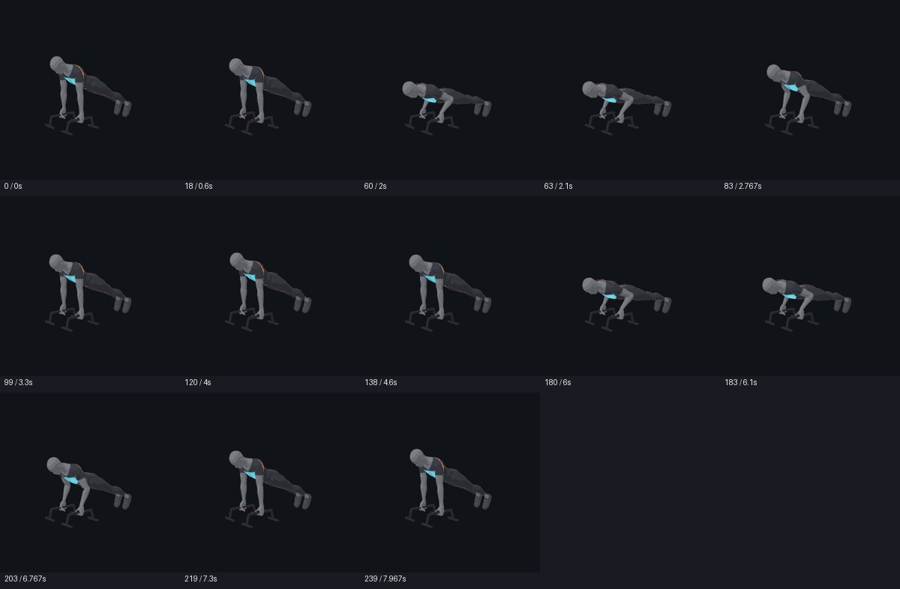
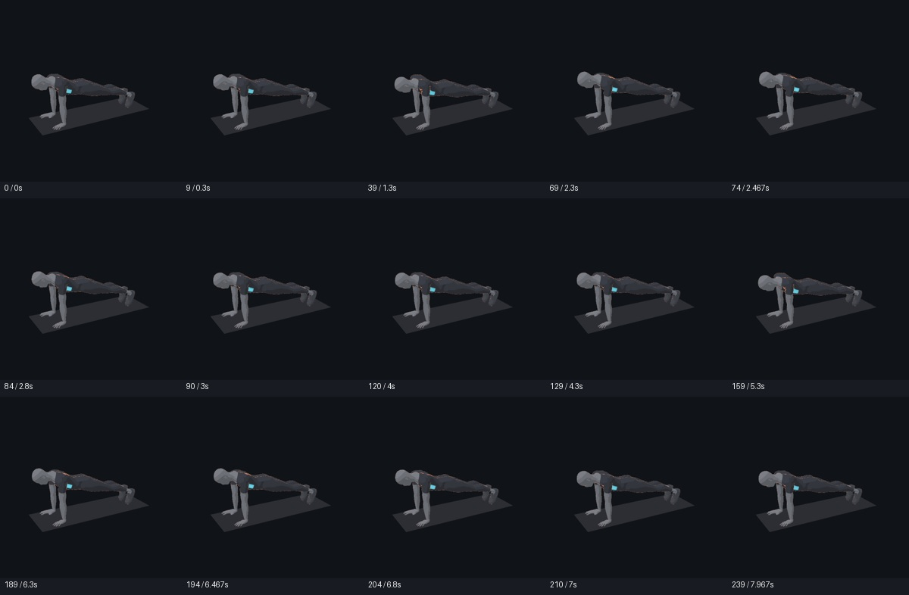
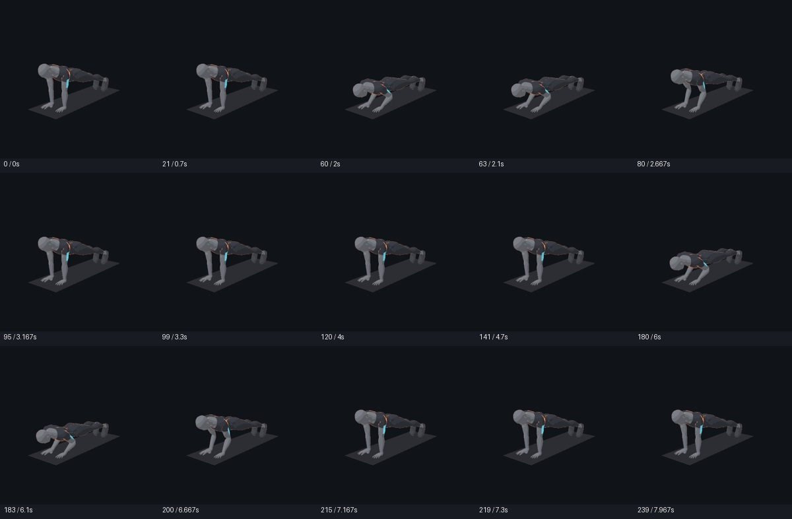
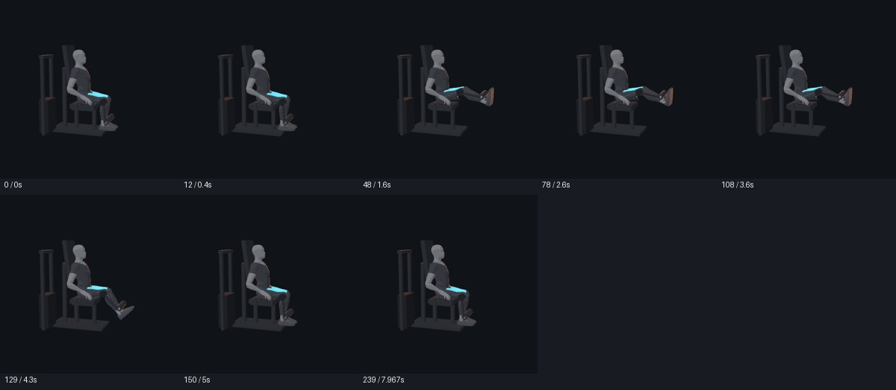

# PR #19 四项独立时序采纳与复测 r2

2026-10-28，按用户授权保留不因身体更新而失效的优化，选择性接入 `chest-B-r2`、`serratus-A-r2`、`triceps-A-r2`、`quadriceps-C-r2` 及其独立 helper；原文件逐字节来自 PR head `6ff2120d7f6be0d34b38c1453f188303356f9d70`。这四项仅保持原运动速度并增加停留／休息，或减少演示重复数，姿态、道具、QA 和默认训练参数没有被改写。

采纳的是时序源码和列出的回归验证，不是全部动作已适配 r7 或公开媒体发布通过。原 helper 中 `sourceQA/visualQA/editorialReview: pending`、`releaseEligible:false` 保留，后续决定由本记录补充；候选登记的完整动作审核与发布仍为 false。全局人体生产配方、AI catalog 版本、媒体和 SDK 未升级。

## 验证结果

- 使用冻结 `page/engine.js` 的实际采样函数作独立 oracle，四项各 240 帧均与映射原源轨道一致，误差低于 `0.00002`；源姿态、道具和 QA 深比较一致，各切片仅单位速度或静止停留。
- 用冻结 r7 在同一页对照源动作与修订动作的对应时刻，检查 51 个最低预览集帧，涵盖首末帧、keyFrames、每次起／顶／回与 stillAt。52 骨最大位置偏差 `0.000164 mm`，最大旋转偏差 `0.000048°`，没有新增或变化的求解告警，页面错误为 0。
- 下列 51 个最终预览均由协调者查看，未发现新增时序断点或采样画面跳变。首次沿用应用相机的实验受到 UI viewOffset 影响，r3 预览脚本清除该偏移并按实际可见人体及道具重设相机；旧实验输出在仓库外保留，不作为当前外观证据。

**原有可达范围告警继续披露**：胸部修订的 13 个采样中有 9 帧、前锯肌修订的 15 个采样中有 6 帧出现手腕／脚踝目标被限制到可达范围的告警；映射原动作在相同姿势的告警逐项相同。肱三头肌 15 帧和股四头肌 8 帧没有该告警。这不是新增时序造成的问题，也不能用“没有新增告警”冒充完整的 v3 动作迁移通过；接触、够距和制作镜头仍应在后续逐项迁移时审核。









详细帧号、独立采样结果、源报告哈希和告警数见 [采样证据](pr19-sampled-evidence-r1.json)；原先的 12 项审查和剩余 8 项的暂缓原因见 [时序初审](pr19-timing-r1.md)。原 PR 保持草稿并标注部分已采纳，不整体合并，不把这 8 项因身体升级判为过时。

## 复现

按项目说明准备本机忽略配置和 Vite；每次只启动一路浏览器，输出目录必须不存在：

```sh
node tools/body-v3/adoption-r1/verify-timing-r1.mjs
node tools/body-v3/adoption-r1/preview-timing-r3.mjs <new-output-directory>
```

新工具始终显式初始化 r7 一次，按 30 fps 对齐采样并记录实际帧号；它没有修改任何冻结模型、原动作或处方。
