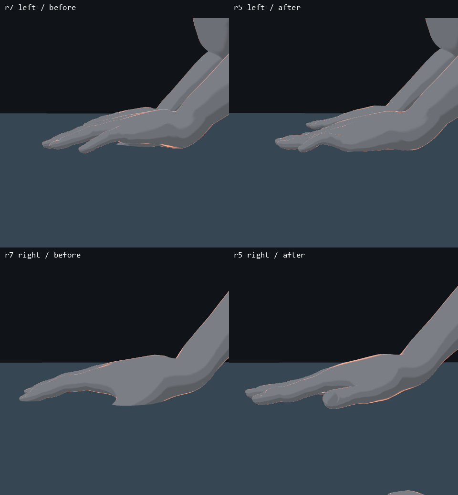
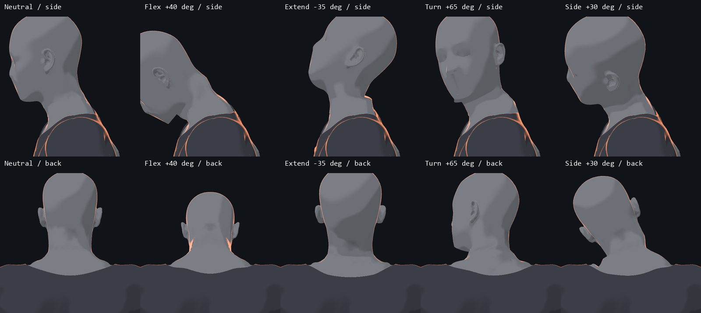
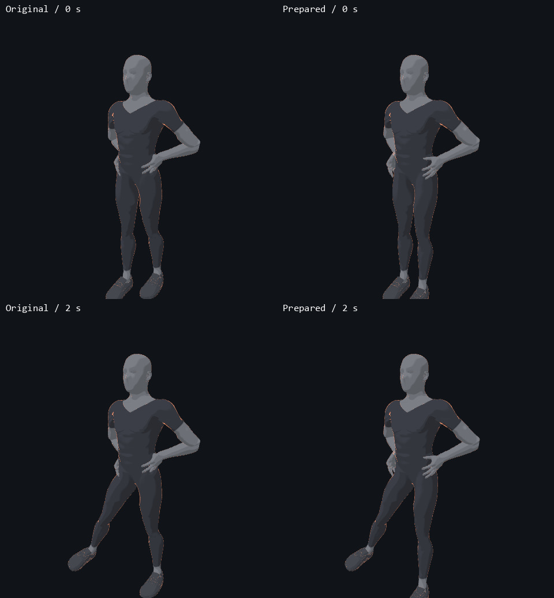

# PR #21 能力迁移到身体 r7 的采纳记录

2026-10-28，保留原 PR `c5d71c59e4a16982ba0c62a3ff9a2aac6df716f3` 的掌面拟合与颈部通道设计，在用户已接受的身体 r7 上另建可选入口 [training-human-v3-contact-r5](../../../drill-anim/models/training-human-v3-contact-r5/loader.mjs)，版本 `0.1.0-r5`。原 PR 的 `native-open-r2` 依赖旧 r3 手部及旧颈部方案，不整体合并；原分支保留，旧包由本实现取代。

新入口初始化冻结 `training-human-v3-completed / 1.0.0-r7` 一次，固定 c1r2 手与 `handScale=1.18`，再安装接触／颈部包装及 [PR #18 预处理](pr18-adoption-r2.md)。左右手分别根据实际网格、指骨支点拟合；右手四元数按冻结 setter 的镜像规则编码。新增 `neck.flex / side / rot` 支持角度、轨道名或 `{track,scale,offset}`，默认半数旋转分配给颈、头部获得完整世界旋转，沿用 r7 的共享接缝方式。

入口 manifest 的 LF SHA-256 为 `60aed9cff5e0754cbead7afbd305aad903f835b52ea3044defeb3de641dc045c`，递归锁定 r7 manifest `676a19e7b4185848ce2570c66a996ba4f967305a03feafe45e4c69b36c7a7fb6`、c1r2 rig 和侧抬腿预处理。r7 模型、网格、权重、骨骼及旧固定源均未修改。新 manifest/README 中的 pending 是建包时状态，保留其 SHA；本记录补充后续实测和采纳范围，不将自动复测写成人工看样通过。

## 实际渲染与测量

用两个先后打开的全新页面分别初始化 r7 基线和 r5 候选，每次只有一路浏览器。测试动作由 main 已有的跪姿俯卧撑、提踵及侧抬腿构造显式 r7 探针，未把探针登记为新动作。共检查双手 `0、2.1、4 s`、中立头颈和四个极限角度的侧／后视图，以及侧抬腿五个时间点的冷／热启动。

手部按真实蒙皮后世界坐标到 `Y=0` 地面的毫米高度统计：掌面和掌根采用手局部纵向选区，指腹按占优第三节指骨及朝下法线选区，P10 为排序后 `floor((n−1)*0.1)`。标准为每侧掌／掌根／五指各有 `[-2,4] mm` 内的点、各区 P10≤4 mm、整只手无低于 −2 mm 的点。以下为三个采样时刻的最差值，并不表示整个掌面都在该高度。

| 测量项 | 左手 | 右手 |
| --- | ---: | ---: |
| 原 r7 整只手最低点 | −27.194 mm | −37.622 mm |
| r5 整只手最低点 | −0.548 mm | 约 0 mm |
| r5 掌面 P10 最大值 | 1.425 mm | 1.017 mm |
| r5 掌根 P10 最大值 | 1.370 mm | 3.153 mm |
| r5 五指各指腹 P10 的最大值 | 1.904 mm | 0.888 mm |
| r5 低于 −2 mm 的点 | 0 | 0 |

上一轮 r4 的左小指 P10 为 6.282 mm，尽管整体指腹统计较好仍未通过，故未交付该版本。r5 单独加入左小指末节目标及有界搜索，保留全指防穿透惩罚，最终左小指 P10 为 1.806 mm；其余九指评分不变。



颈部测试为低头 `40°`、抬头 `35°`、转头 `65°`、侧倾 `30°`。四态均保留 162 个共享接缝顶点及 162 条双面共边；报告里的 gap=0 是同一顶点索引的拓扑事实，**不是独立测出的两层网格距离**。邻面夹角 P95≈26.168°、最大≈73.298° 是原有形状的相邻面夹角，不能当作顶点法线连续误差。中立侧／后图与原 r7 PNG 逐字节相同；协调者查看十张中立／极限图，未见新增裂口或碎片，保留用户已接受的下颌轮廓和自然阴影。



侧抬腿通用修法的原／新实拍如下，具体漂移及未验收项目见 [PR #18 r2](pr18-adoption-r2.md)。该组镜头用于身体与手部对照，不作为全鞋底或整套动作通过的证据。



## 骨架、生命周期与边界

实际安装前后，52 骨／30 指骨的对象引用、名称、父子关系和局部静止变换均相同；手部选择对象及控制器 mode/time/angle/groundLock、躯干旋转和告警状态不变。卸载恢复原 `E.pose`、ground-hand 函数、手姿 setter、私有别名表、原 palm-floor 数据和正在使用的原手指姿态；控制器状态不变，页面错误为 0。CPU 测试另外覆盖非有限 rest、错误父子关系、早／晚异常回滚、右手编码和非 palm 姿态委托。

r7 底座的部分几何／材质钩子本来就与页面同寿命；完整清空仍需销毁页面，不允许在同一页面重复初始化。本扩展是显式 opt-in，未改全局生产配方，未宣布全部动作、其他手向／支撑角、道具握持或持续播放通过。本次是已授权的能力采纳与局部自动／画面复核，用户对 r7 的原看样确认不自动扩展到全部新动作。

## 复现与来源

```sh
node tools/body-v3/adoption-r1/verify-prepare-spec-r1.mjs
node tools/body-v3/contact-r1/test-runtime-r5.mjs
node tools/body-v3/contact-r1/verify-live-r7.mjs <new-output-directory>
```

先按项目配置启动 Vite，并设置 `APP_URL`。默认脚本新建基线和候选页面，不复用已摆姿态的页面；输出目录必须不存在。脚本对每个指腹分别断言验收标准，失败写出 failure.json 并退出非零，不能用整体手指统计掩盖单指悬空。

完整原始 PNG 和报告留在仓库外 `E:/AII-3D/codex-output/pr17-22-adoption-20261028/pr21-contact-canonical-r5/`。报告 SHA-256 为 `88e894f1fa0444c6e2f1e30befe580301c3f32cf23eba847d9ce24464a4a532b`；[已提交机器摘要](pr21-sampled-evidence-r1.json)记录采样、原图哈希、逐区数据和生命周期结果，JPG 是原渲染帧的排版预览。原 PR 更新时引用实际采纳提交；不删除旧分支。

推送前三项检查通过：`node drill-anim/verify.mjs`（301 规格、原哈希保留）、`python -B drill-anim/test_portability.py`（7 项）、`node drill-anim/tools/catalog.mjs --check`（up to date）。新扩展另做递归验签、CPU 生命周期／求解检查、上述 GPU 复核及暂存区依赖哈希核对。已有源码未改；新 runtime 的一个随清单锁定的空白行原样保留，其余新增文档／工具的 whitespace 检查通过。
