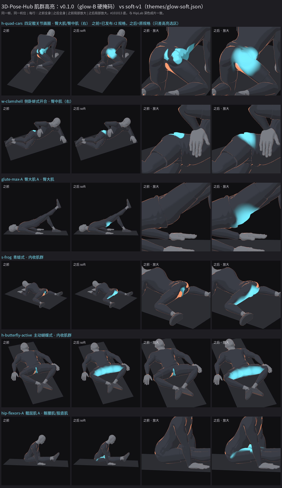

# 肌群高亮 v2「soft-v1」（2026-10-18）

HipLab 自测反馈：动作视频里的青色肌群高亮边缘不圆润、成锯齿/碎块，像穿模（典型：四足画圈臀部高亮碎成几片贴在臀上，边缘硬、有块面）。
本次新增一套**可选**的柔和高亮，主题 `drill-anim/themes/glow-soft.json` 打开；旧主题、旧批次、已发布的 v0.1.0 一概不变。



## 成因

1. **肌肉图坐标在髋部被撕开。** `page/posedlib.js` 给每个顶点算 `mmRest`（肌肉图坐标）时，是把各骨骼的**刚体**重定向按蒙皮权重直接平均。
   人物 reset 姿态下腿和手臂的朝向与肌肉图里的站姿人台差很多，于是同时绑骨盆和大腿的顶点（短裤、腹股沟、臀下沿）落在两个相差很大的变换中间：
   短裤上绑大腿的顶点在肌肉图里平均偏了约 0.25–0.37 m，皮肤、T 恤、短裤三层在每条衣服边缘处互相对不上。
   掩码按三角形插值这种跳变的坐标，就出现一块一块的碎片和硬台阶。
2. **掩码本身是硬边。** `page/toon.js` 的 `hlMask` 是“选中面板得分 − 最佳未选面板得分”的 Voronoi 分区，边缘只用 1–2 像素的 `fwidth` 抗锯齿：
   面板之间的分界是折线，任何坐标误差都会显成锋利的锯齿；r2 规格靠拼面板（glutes + gluteMed + oblique、inset 0.08）只能部分缓解。
3. 没有 z-fighting 或独立发光外壳：高亮完全在衣服/皮肤自身的着色里，问题都来自上面两点。

## 方案（soft-v1）

全部在运行时给 toon 着色器打补丁（`drill-anim/page/soft-highlight.js`），**不改** `training-human-v2` 固定的 13 个源文件，不加任何几何体，因此不可能和衣服穿插：

- **连续的肌肉图坐标**：把骨架摆成与人台同向的站姿（每段肢体旋到人台方向），用正常的线性混合蒙皮算出每个网格顶点的位置，
  再按段做平滑缩放（同一套骨骼、同一套权重，皮肤/T 恤/短裤天然连续）。结果存成每网格一张顶点纹理，顶点着色器按 `gl_VertexID` 取出。
- **圆润的场**：只看被选中的肌肉椭球，平滑并集（log-sum-exp，两个椭球相接处没有折痕），从椭球 0.35 倍处满亮到 1.1 倍处完全消失；
  横向（跨肢体/躯干厚度方向）放宽 1.4 倍，减少雕刻凸起造成的明暗珠串。
- **软竞争**：未选中的面板明显更近（超过 0.22）时才在 0.4 的宽带内淡出，保证光晕大致落在正确的肌肉上，但不会出现折线边界；
  单侧高亮用 3.5 cm 的软中线淡出。
- **着色**：同一青色 `[0.18, 0.82, 1.0]`（线性值，屏幕上约 #76eaff，与 glow-B 相同，即原来的青色 glow），以柔和环境光为主、少量 lambert 与中心增亮，再加一层 fresnel 边缘光，
  读起来是“这块在发力的光晕”，而不是贴上去的色块。脉冲（`pulseAt` / `pulseTrack`）照旧调制亮度。

参数全部写在 `themes/glow-soft.json` 的 `highlight.soft` 里（`e0/e1/size/depth/compete/margin/gain/ambient/lambert/core/fresnel/rim/midline`），
含义见 `page/soft-highlight.js` 顶部注释。

## 开关与版本

| 项 | 说明 |
| --- | --- |
| 开关 | 主题里有 `highlight.soft` 且 `on` 不为 `false` 才启用；`lib/soft-highlight.mjs` 在 `boot()` 之后注入补丁，`lib/render.mjs`、`batch-rerender.mjs` 已接入，渲染日志打印 `highlight {"version":"soft-v1",...}`，`batch-rerender` 记入 `renderer.json.softHighlight` |
| 新渲染默认 | HipLab 新成片使用 `--theme themes/glow-soft.json`（替代 `themes/glow-b.json`）。`theme.json` 属于人物模型固定源，没有改，所以不带 `--theme` 的普通 CLI 仍是 v7 默认外观 |
| 旧批次可复现 | `glow-b.json`、`theme.json` 及其他主题不会加载补丁。实测：`origin/main` 与本分支用 glow-B 渲染 h-quad-cars 第 66 帧，m-/g- 两张 PNG 的 SHA-256 完全相同（`68a86dc0…`、`270fbced…`） |
| 冻结 | `page/soft-highlight.js`、`lib/soft-highlight.mjs`、`themes/glow-soft.json` 的哈希登记在 `verify.mjs`；要改外观请另起 soft-v2（新文件/新主题），不要改 v1 |
| 人物模型 | 仍是 `training-human-v2`（13 个源哈希不变）。补丁只改高亮着色，动作、机位、求解器、QA 指标完全不受影响 |

## h-quad-cars 规格选择

`h-quad-cars-r2` 只改了高亮选区（为了绕开碎片：glutes + gluteMed + oblique、inset 0.08），动作、机位、时间与原规格完全相同。
soft-v1 下原规格的选区（臀大肌 + 臀中肌，右侧）已经是一整块干净的光晕，r2 多出来的 oblique 反而在腰侧多出一团。
**建议 v0.2.0 的 h-quad-cars 绑定原规格 `drill-anim/specs/h-quad-cars.js`**（总览图第一行“之后”即原规格）。其余 45 项规格绑定与 v0.1.0 相同。

## 验证（沙盒，SwiftShader）

- 6 个 HipLab 动作同一帧对比（h-quad-cars、w-clamshell、glute-max-A、s-frog-r2、h-butterfly-active、hip-flexors-A），PR2（2160² 原始）渲染，逐张看过全身与局部放大：
  之前的碎片/锯齿/台阶消失，光晕圆润、边缘柔和、跨衣服边缘连续；glute-max-A 与 hip-flexors-A 之前几乎看不到高亮，现在在对应部位可见。
- 动画稳定性：h-quad-cars 第 40–99 帧连续 60 帧，统计青色权重在三帧内“升-降/降-升”超过 0.25 的像素：glow-B 平均 0.9 px/帧（光晕面积约 1.6k px），
  soft-v1 平均 1.8 px/帧（光晕面积约 5.4k px，占比更低），两者都没有超过 50 px 的帧，目视无闪烁。
- `node drill-anim/verify.mjs` 通过（原规格与 13 个人体固定源哈希不变，新登记 3 个 soft 源）；`python drill-anim/test_portability.py` 7 项通过；
  `python -m unittest discover -s media/tests` 28 项通过。

## 主线本机待办：v0.2.0

沙盒没有做全量重渲。请在 4080 本机：

```powershell
git checkout main; git pull            # 合并本 PR 后
node drill-anim/verify.mjs
python drill-anim/test_portability.py
python -m unittest discover -s media/tests -v

# 1) 预览：几个代表动作各 2–3 帧，确认日志有 highlight {"version":"soft-v1"...}，再看 work_dir/<id>/c/ 的预览帧
python drill-anim/drill.py render h-quad-cars glute-max-A s-frog-r2 --theme themes/glow-soft.json --frames 0,66,120 --jobs 1 --pr 2

# 2) 全量 46 项：沿用 v0.1.0 r2 四项的本机制作链（PR2 2160² 原始 m- 帧 → 1080 直通 alpha 母帧 → #101013 深色 H.264 yuv420p CRF18 slow + 540 封面；绿幕 r2-v3 配方），
#    规格与 renderProfile 包装照 media/releases/0.1.0.sources.json，只改两处：
#      主题：drill-anim/themes/glow-soft.json（替代 themes/glow-b.json）
#      h-quad-cars：绑定原规格 drill-anim/specs/h-quad-cars.js（不再用 -r2）
#    单项示例（drill.py 路线，--keep 保留 fr/m-*.png 原始帧给导出用）：
python drill-anim/drill.py render <id> --theme themes/glow-soft.json --jobs 1 --pr 2 --keep
#    整机最多两路、每路 --jobs 1；先跑 3–5 项抽查再放开

# 3) 新批次目录（不要覆盖 v0.1.0 的批次和统一目录），QA：动作 QA、绿幕合成 QA、全片解码、flickscan；
#    抽看每项首/中/末帧的高亮
# 4) ingest → 打包 pose-hub-media-v0.2.0.zip → 云盘 releases/v0.2.0/ → 回读核验 → published；主线按用户授权直接提交推送 main
```

v0.1.0 保持 published、文件不动；App 端改为同步 v0.2.0 即可。

## 遗留

- 光晕位置按肌肉图椭球估计，只求“大概在这块肌肉上”，不是解剖级；深层肌（髋屈肌、深层外旋肌）显示的是体表投影。
- 腿部雕刻的分段线在大面积光晕（如主动蝴蝶式的大腿内侧）里仍能隐约看到明暗珠串，比旧版轻很多；需要的话可在 soft-v2 继续压低 lambert。
- 根治 `mmRest` 的做法（重新烘焙肌肉图坐标）仍需要新人物版本；soft-v1 在补丁里自己算坐标，绕开了这一步。
